# 二、连续信号的分析

## 1. 连续信号的时域描述

### （1）普通信号

#### 正弦信号

$$
x(t)=A\sin(\omega_0t+\varphi_0)
=A\cos\left(\omega_0t+\varphi_0-\frac\pi2\right),
\qquad-\infty<t<+\infty.
$$

振幅 $A$，角频率 $\omega_0$，初相 $\varphi_0$，周期 $T=2\pi/\omega_0$。

性质：

- 两个同频率的正弦信号相加，仍是原频率的正弦信号。
- 若一正弦信号频率 $f_1$ 为另一正弦信号频率 $f_0$ 的整数倍，即 $f_1=nf_0$，$n\in\mathbb Z$，则合成信号为频率 $f_0$ 的周期信号；$f_0$ 为基波频率，$f_1$ 为 $n$ 次谐波频率。
- 正弦信号的微分和积分仍是同频率的正弦信号。
- 两个正弦信号相加，若其周期之比<strong>为有理数</strong>，则结果仍为周期信号；其周期为 $T_1,T_2$ 的最小公倍数。

#### 指数信号

$$
x(t)=Ae^{st},\qquad-\infty<t<+\infty,
\qquad s=\sigma+j\omega_0.
$$

其中 $s$ 为复数。由欧拉公式：

$$
x(t)=Ae^{st}
={\color{#c62828}Ae^{\sigma t}\bigl(\cos\omega_0t+j\sin\omega_0t\bigr)}
=\operatorname{Re}[x(t)]+j\operatorname{Im}[x(t)].
$$

即

$$
\operatorname{Re}[x(t)]=Ae^{\sigma t}\cos\omega_0t,
\qquad
\operatorname{Im}[x(t)]=Ae^{\sigma t}\sin\omega_0t.
$$

- $\sigma=0,\omega_0=0$：直流信号。
- $\sigma=0,\omega_0\neq0$：实、虚部等幅的（复）正弦信号。
- $\sigma\neq0,\omega_0=0$：实指数信号。
- $\sigma\neq0,\omega_0\neq0$：指数包络的正弦振荡；$Ae^{\sigma t}$ 反映振幅变化，即包络线。$\sigma<0$ 时收敛，$\sigma>0$ 时发散。

### （2）奇异信号

信号本身或导数有不连续点。

#### 单位斜坡信号

$$
r(t)=\begin{cases}t,&t\geq0,\\0,&t<0.\end{cases}
$$

截平的斜变信号：

$$
f_1(t)=
\begin{cases}
\dfrac K\tau r(t),&t<\tau,\\
K,&t\geq\tau.
\end{cases}
$$

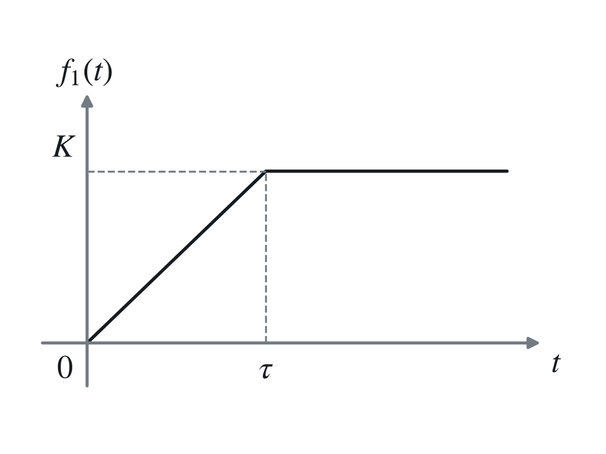

#### 单位阶跃信号

$$
u(t)=\begin{cases}1,&t>0,\\0,&t<0.\end{cases}
$$

$t=0$ 时未定义，或约定 $u(0)=1/2$。

$$
{\color{#c62828}\frac{\mathrm dr(t)}{\mathrm dt}=u(t)}.
$$

矩形脉冲：

$$
{\color{#c62828}G_\tau(t)=u\left(t+\frac\tau2\right)-u\left(t-\frac\tau2\right)}.
$$

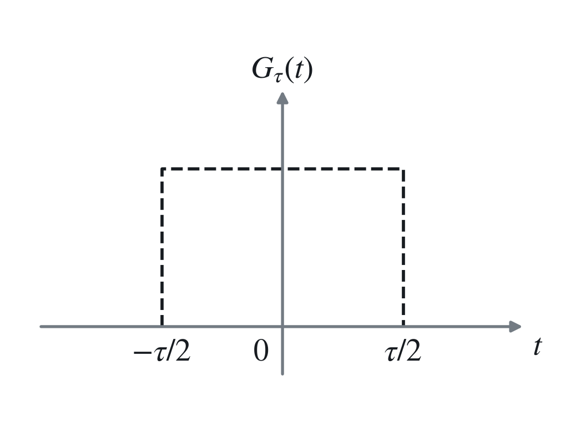

#### 单位冲激信号

涵盖面积恒为 $1$ 的理想函数：

$$
\delta(t)=0\quad(t\neq0),\qquad
\int_{-\infty}^{+\infty}\delta(t)\,\mathrm dt
=\int_{0^-}^{0^+}\delta(t)\,\mathrm dt=1.
$$

$$
\delta(t)=\lim_{\tau\to0^+}\frac1\tau
\left[u\left(t+\frac\tau2\right)-u\left(t-\frac\tau2\right)\right],
$$

$$
{\color{#c62828}\frac{\mathrm du(t)}{\mathrm dt}=\delta(t)}.
$$

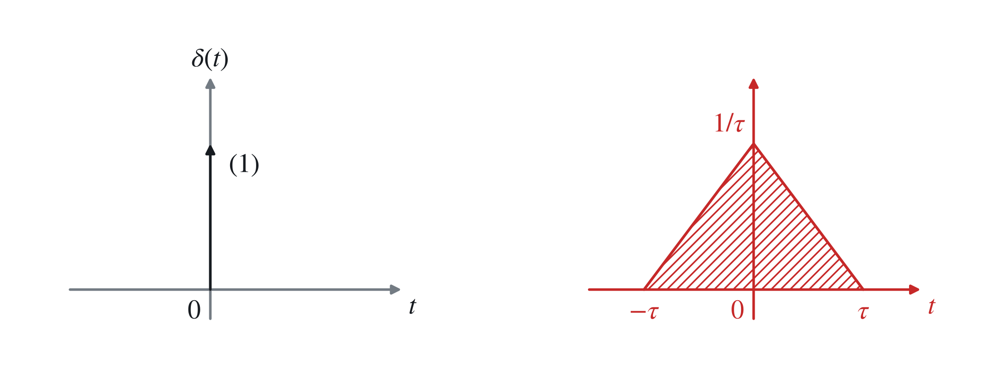

筛选特性：若 $f(t)$ 在 $t=t_0$ 处连续，则

$$
\int_{-\infty}^{+\infty}f(t)\delta(t-t_0)\,\mathrm dt=f(t_0).
$$

偶函数特性：

$$
\delta(t)=\delta(-t).
$$

#### 单位冲激偶信号

$\delta'(t)$。对三角脉冲微分：

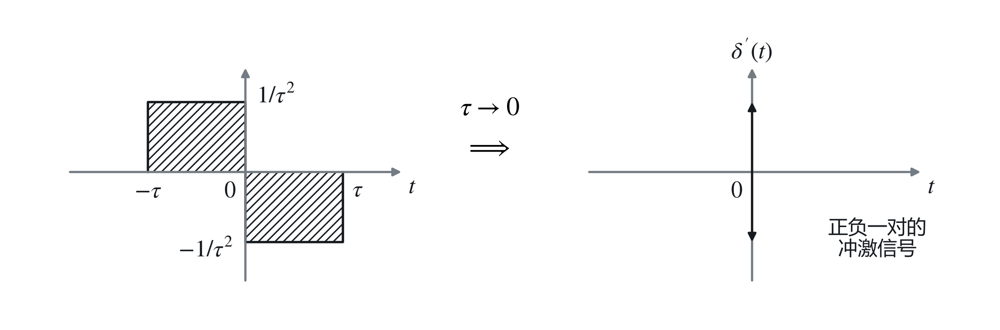

性质：若 $f'(t)$ 在 $t_0$ 点连续，则

$$
\int_{-\infty}^{+\infty}\delta'(t-t_0)f(t)\,\mathrm dt
={\color{#c62828}-f'(t_0)}.
$$

面积为 $0$：

$$
\int_{-\infty}^{+\infty}\delta'(t)\,\mathrm dt=0.
$$

奇函数：

$$
\int_{-\infty}^{+\infty}\delta'(-t)f(t)\,\mathrm dt=f'(0).
$$

## 2. 连续信号的时域运算

### （1）尺度变换

幅度尺度变换：

$$
f_2(t)=af_1(t).
$$

不改变信号基本特征。

时间尺度变换：

$$
f_2(t)=f_1(at).
$$

改变信号基本特征，频谱发生变化。

### （2）翻转与平移

翻转：

$$
f_2(t)=f_1(-t).
$$

平移，取 $t_0>0$：

- 滞后：$f_2(t)=f_1(t-t_0)$，右移。
- 超前：$f_2(t)=f_1(t+t_0)$，左移。

### （3）叠加和相乘

$$
f(t)=f_1(t)+f_2(t),\qquad
f(t)=f_1(t)f_2(t).
$$

### （4）微分和积分

微分突出信号变化，积分平滑变化部分。

### （5）卷积运算

对两个连续时间信号 $x_1(t),x_2(t)$，卷积分运算为

$$
x_1(t)*x_2(t)
=\int_{-\infty}^{+\infty}x_1(\tau)x_2(t-\tau)\,\mathrm d\tau
=\int_{-\infty}^{+\infty}x_2(\tau)x_1(t-\tau)\,\mathrm d\tau.
$$

#### ① 计算步骤

变量替换：$x_1(t),x_2(t)\to x_1(\tau),x_2(\tau)$。

翻转、平移：$x_2(-\tau)$ 平移 $t$ 得 $x_2(t-\tau)$。

相乘、积分。

#### ② 时宽

卷积结果占有的时宽等于两个函数各自时宽的总和。

#### ③ 意义

卷积实质上是对信号进行<strong>滤波</strong>。物理上代表系统对某个物理量的调制或污染；可通过卷积把一些非光滑的函数或算子光滑化。

例：

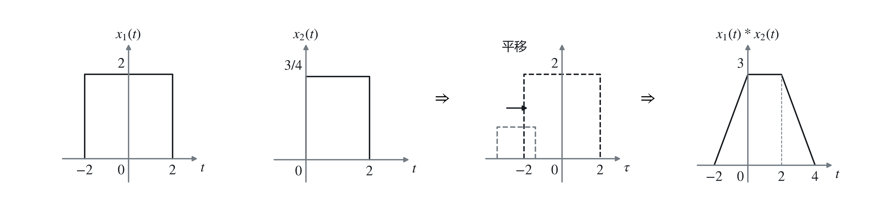

#### ④ 性质

交换律：

$$
x_1(t)*x_2(t)=x_2(t)*x_1(t).
$$

分配律：

$$
x_1(t)*[x_2(t)+x_3(t)]=x_1(t)*x_2(t)+x_1(t)*x_3(t).
$$

结合律：

$$
x_1(t)*[x_2(t)*x_3(t)]=[x_1(t)*x_2(t)]*x_3(t).
$$

卷积的微分：

$$
\frac{\mathrm d}{\mathrm dt}(x_1*x_2)
=x_1(t)*\frac{\mathrm dx_2(t)}{\mathrm dt}
=\frac{\mathrm dx_1(t)}{\mathrm dt}*x_2(t).
$$

卷积的积分：

$$
\int_{-\infty}^{t}(x_1*x_2)(\lambda)\,\mathrm d\lambda
=x_1*\left(\int_{-\infty}^{t}x_2(\lambda)\,\mathrm d\lambda\right)
=\left(\int_{-\infty}^{t}x_1(\lambda)\,\mathrm d\lambda\right)*x_2.
$$

与冲激信号卷积：

$$
x(t)*\delta(t)=x(t),
$$

$$
{\color{#c62828}x(t-t_1)*\delta(t-t_2)=x(t-t_1-t_2)},
\qquad x(t)*\delta'(t)=x'(t).
$$

与阶跃信号卷积：

$$
x(t)*u(t)=\int_{-\infty}^{t}x(\tau)\,\mathrm d\tau.
$$

一般情形：

$$
x(t)*\delta^{(n)}(t-t_0)=x^{(n)}(t-t_0).
$$

$n$ 为正整数表示 $n$ 重微分，为负整数表示 $n$ 重积分。

## 3. 时域分解

### （1）分解成冲激函数之和

$$
\begin{aligned}
f(t)&=\sum_{k=-\infty}^{+\infty}f(k\Delta t)
\bigl[u(t-k\Delta t)-u(t-(k+1)\Delta t)\bigr]\\
&=\sum_{k=-\infty}^{+\infty}\frac{f(k\Delta t)}{\Delta t}
\bigl[u(t-k\Delta t)-u(t-(k+1)\Delta t)\bigr]\Delta t.
\end{aligned}
$$

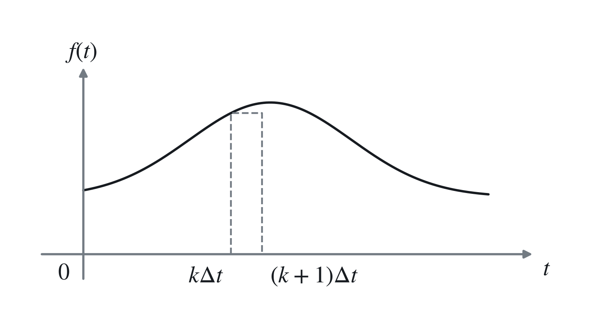

令 $\Delta t\to0$，有 $\Delta t\to\mathrm d\tau$、$k\Delta t\to\tau$，且

$$
\lim_{\Delta t\to0}\frac1{\Delta t}\bigl[u(t-k\Delta t)-u(t-(k+1)\Delta t)\bigr]
=\delta(t-\tau).
$$

得

$$
f(t)=\int_{-\infty}^{+\infty}f(\tau)\delta(t-\tau)\,\mathrm d\tau
=f(t)*\delta(t).
$$

### （2）正交分解

#### ① 对二维向量

$$
x=c_1y_1+c_2y_2
\quad\Rightarrow\quad
y_1^{\mathsf T}x=c_1y_1^{\mathsf T}y_1+c_2y_1^{\mathsf T}y_2.
$$

由 $y_1,y_2$ 正交，得

$$
y_1^{\mathsf T}x=c_1y_1^{\mathsf T}y_1,\qquad
c_1=\frac{\langle x,y_1\rangle}{\langle y_1,y_1\rangle}.
$$

这里 $\langle\cdot,\cdot\rangle$ 为向量内积。

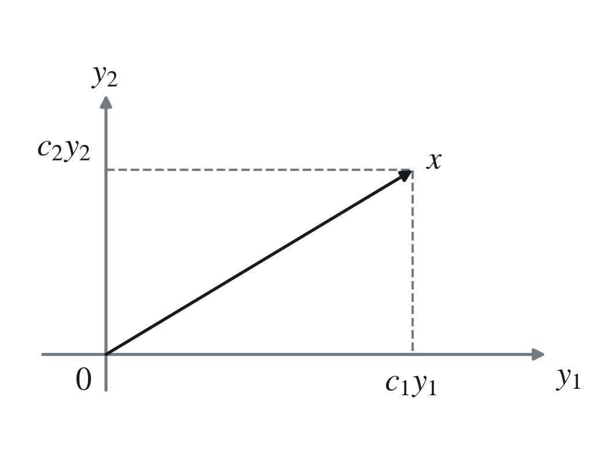

#### ② 推广到 $n$ 维向量空间

$V_1,\ldots,V_n$ 正交，表示向量 $x$：

$$
x=\sum_{i=1}^{n}c_iV_i,\qquad
c_i=\frac{\langle x,V_i\rangle}{\langle V_i,V_i\rangle},
\quad i=1,2,\ldots,n.
$$

#### ③ 正交函数集

对两个非零函数 $f_1(t),f_2(t)$，可为复函数，若满足

$$
{\color{#c62828}\int_{t_1}^{t_2}f_1(t)f_2^*(t)\,\mathrm dt=0},
$$

即内积为 $0$，$*$ 表示共轭，则称 $f_1(t),f_2(t)$ 在 $(t_1,t_2)$ 内<strong>正交</strong>。

考虑 $n$ 个非零函数 $f_1(t),\ldots,f_n(t)$ 构成的函数集，若在 $(t_1,t_2)$ 内满足

$$
\int_{t_1}^{t_2}f_i(t)f_j^*(t)\,\mathrm dt
=\begin{cases}0,&i\neq j,\\k_i,&i=j,\end{cases}
$$

其中 $k_i$ 为常数，则称该函数集在 $(t_1,t_2)$ 内为正交函数集。

#### ④ 完备正交函数集

$f_1(t),\ldots,f_n(t)$ 在 $(t_1,t_2)$ 内为正交函数集，且不存在非零函数 $\varphi(t)$ 满足

$$
\int_{t_1}^{t_2}f_i(t)\varphi^*(t)\,\mathrm dt=0,
\qquad i=1,2,\ldots,n.
$$

#### ⑤ 常见完备正交函数集

<strong>三角函数集</strong>，在区间 $(t_0,t_0+T)$ 内，$T=2\pi/\omega_0$：

$$
\{1,\cos\omega_0t,\cos2\omega_0t,\ldots,
\sin\omega_0t,\sin2\omega_0t,\ldots\}.
$$

<strong>复指数函数</strong>，在区间 $(t_0,t_0+T)$ 内，$T=2\pi/\omega_0$：

$$
\{e^{jn\omega_0t}\},\qquad n=0,\pm1,\pm2,\ldots.
$$

### （3）信号的正交分解

$$
{\color{#c62828}x(t)=\sum_{i=1}^{n}c_if_i(t)+x_e(t)},
\qquad t\in(t_1,t_2).
$$

$f_i(t)$ 为实信号。选取系数 $c_i$，使该线性组合接近原信号 $x(t)$。

<strong>均方误差：</strong>

$$
\overline{x_e^2}
=\frac1{t_2-t_1}\int_{t_1}^{t_2}
\left(x(t)-\sum_{i=1}^{n}c_if_i(t)\right)^2\,\mathrm dt,
$$

其中

$$
c_i=\frac{\displaystyle\int_{t_1}^{t_2}x(t)f_i(t)\,\mathrm dt}
{\displaystyle\int_{t_1}^{t_2}f_i^2(t)\,\mathrm dt}.
$$

推导近似系数：

- 法一：$\partial\overline{x_e^2}/\partial c_i=0$。
- 法二：类比内积。

$$
c_i=\frac{\displaystyle\int_{t_1}^{t_2}x(t)f_i^*(t)\,\mathrm dt}
{\displaystyle\int_{t_1}^{t_2}f_i(t)f_i^*(t)\,\mathrm dt}.
$$

$$
\begin{aligned}
\langle x,f_i\rangle
&=\int_{t_1}^{t_2}x(t)f_i^*(t)\,\mathrm dt\\
&=\sum_{j=1}^{n}c_j\int_{t_1}^{t_2}f_j(t)f_i^*(t)\,\mathrm dt
\quad(\text{利用了 }x(t)=\sum_{i=1}^{n}c_if_i(t)\text{ 的近似})\\
&=c_i\int_{t_1}^{t_2}f_i(t)f_i^*(t)\,\mathrm dt
\quad\text{（利用了正交的性质）}.
\end{aligned}
$$

若 $\overline{x_e^2(t)}=0$，则 $x(t)$ 可由 $n$ 个正交函数精确表述，正交函数集完备。

一般 $\overline{x_e^2(t)}>0$，$n$ 越大均方误差越小；$n\to\infty$ 时有 $\overline{x_e^2(t)}=0$ 及

$$
{\color{#c62828}
\int_{t_1}^{t_2}x^2(t)\,\mathrm dt
=\sum_{i=1}^{\infty}c_i^2k_i
},
\qquad
k_i=\int_{t_1}^{t_2}f_i(t)f_i^*(t)\,\mathrm dt.
$$

为<strong>帕斯瓦尔（Parseval）方程</strong>，表示信号的能量关系。

## 4. 连续信号的频域分析

### （1）傅里叶级数存在的充分条件

在一个周期内：若有间断点，则只有有限个；极大值、极小值只有有限个；信号绝对可积，即

$$
\int_{t_0}^{t_0+T}|f(t)|\,\mathrm dt<\infty.
$$

### （2）三角函数形式的 Fourier 级数展开式

$f(t)$ 的周期为 $T_1$，基波角频率为 $\omega_1=2\pi/T_1$：

$$
f(t)=a_0+\sum_{n=1}^{\infty}
\bigl[a_n\cos(n\omega_1t)+b_n\sin(n\omega_1t)\bigr],
$$

其中

$$
a_0=\frac1{T_1}\int_{-T_1/2}^{T_1/2}f(t)\,\mathrm dt,
$$

$$
a_n=\frac2{T_1}\int_{-T_1/2}^{T_1/2}f(t)\cos(n\omega_1t)\,\mathrm dt,
\qquad
b_n=\frac2{T_1}\int_{-T_1/2}^{T_1/2}f(t)\sin(n\omega_1t)\,\mathrm dt.
$$

（直流分量可写为 $a_0/2$，其中 $a_0=(2/T_1)\int_{-T_1/2}^{T_1/2}f(t)\,\mathrm dt$，本质上没区别。）

$a_n,b_n$ 可通过本章第 3 节的内积法推导。

<strong>三角函数形式的 Fourier 级数</strong>

$$
a_n=c_n\cos(-\varphi_n)=c_n\cos\varphi_n,
\qquad
b_n=c_n\sin(-\varphi_n)=-c_n\sin\varphi_n.
$$

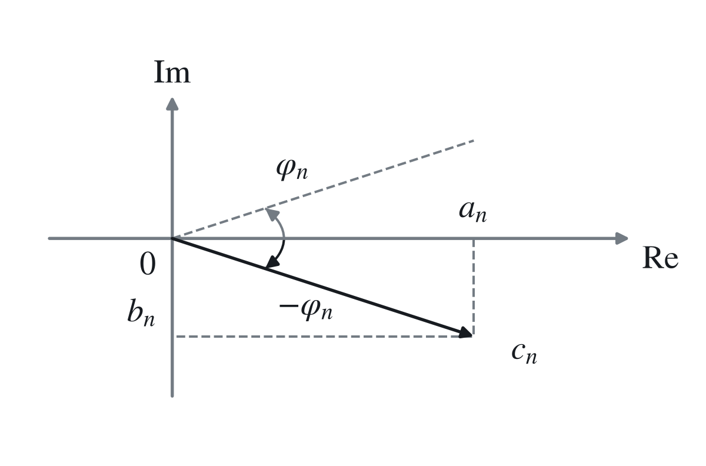

故

$$
\begin{aligned}
f(t)
&=a_0+\sum_{n=1}^{\infty}
\bigl[a_n\cos(n\omega_1t)+b_n\sin(n\omega_1t)\bigr]\\
&=a_0+\sum_{n=1}^{\infty}c_n
\bigl[\cos\varphi_n\cos(n\omega_1t)-\sin\varphi_n\sin(n\omega_1t)\bigr]\\
&={\color{#c62828}c_0+\sum_{n=1}^{\infty}c_n\cos(n\omega_1t+\varphi_n)}.
\end{aligned}
$$

其中

$$
c_0=a_0=\frac1{T_1}\int_{-T_1/2}^{T_1/2}f(t)\,\mathrm dt,\qquad c_n=\sqrt{a_n^2+b_n^2},
\qquad \varphi_n=-\arctan\frac{b_n}{a_n}.
$$

基波分量对应 $n=1$，二次谐波分量对应 $n=2$，依此类推。

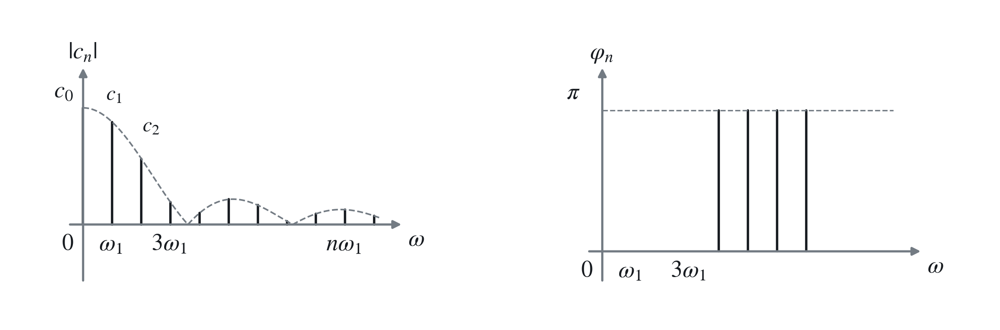

周期信号的频谱只出现在 $0,\omega_1,2\omega_1,\ldots$ 离散频率点上，称为<strong>离散谱</strong>。

### （3）复指数傅里叶级数

由

$$
\cos(n\omega_1t)=\frac12(e^{jn\omega_1t}+e^{-jn\omega_1t}),
\qquad
\sin(n\omega_1t)=\frac1{2j}(e^{jn\omega_1t}-e^{-jn\omega_1t}),
$$

故

$$
\begin{aligned}
f(t)
&=a_0+\sum_{n=1}^{\infty}[a_n\cos(n\omega_1t)+b_n\sin(n\omega_1t)]\\
&=a_0+\sum_{n=1}^{\infty}
\left(\frac{a_n-jb_n}{2}e^{jn\omega_1t}
+\frac{a_n+jb_n}{2}e^{-jn\omega_1t}\right)\\
&=F(0)+\sum_{n=1}^{\infty}
\left(F(n\omega_1)e^{jn\omega_1t}+F(-n\omega_1)e^{-jn\omega_1t}\right)\\
&={\color{#c62828}\sum_{n=-\infty}^{+\infty}F(n\omega_1)e^{jn\omega_1t}}.
\end{aligned}
$$

<strong>记 $F_n=F(n\omega_1)$。</strong> 则 $F_n,F_{-n}$ 互为共轭。

由于 $a_n$ 为 $n$ 的偶函数，$b_n$ 为 $n$ 的奇函数，记

$$
F(n\omega_1)=\frac{a_n-jb_n}{2},\qquad
F(-n\omega_1)=\frac{a_n+jb_n}{2}.
$$

$$
F_n=\frac{a_n-jb_n}{2}
=\frac1{T_1}\int_{-T_1/2}^{T_1/2}f(t)(\cos n\omega_1t-j\sin n\omega_1t)\,\mathrm dt
=\frac1{T_1}\int_{-T_1/2}^{T_1/2}f(t)e^{-jn\omega_1t}\,\mathrm dt.
$$

由左图几何关系易得

$$
{\color{#c62828}F_n=\frac12c_ne^{j\varphi_n}}
=|F_n|e^{j\varphi_n},
$$

$$
F_n+F_{-n}=a_n,\qquad
|F_n|=|F_{-n}|=\frac12|c_n|,\qquad
b_n=j(F_n-F_{-n}).
$$

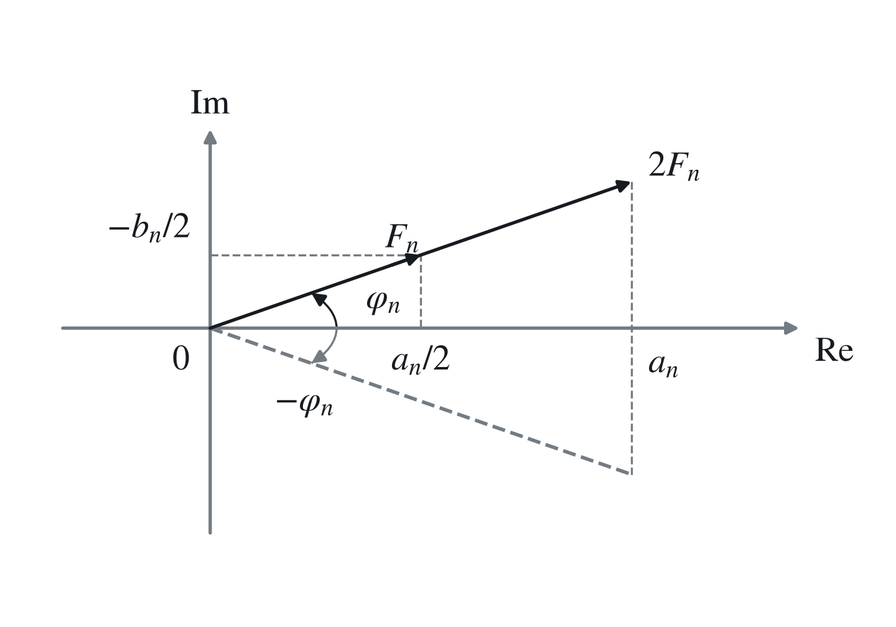

把负频率项和相应的正频率项成对合并起来才是实际频谱比较。

$|F_n|$ 反映各谐波分量的幅度，随频率分布为幅度频谱。

$\varphi_n$ 反映各谐波分量的相位，随频率分布为相位频谱。$f(t)$ 为实信号时分别为偶、奇函数，为双边谱。

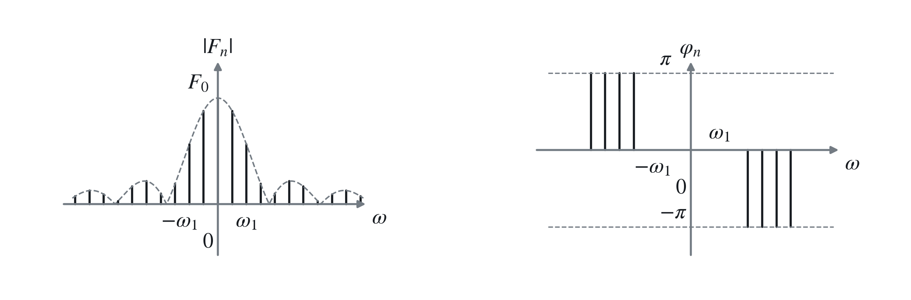

当 $F_n$ 为实数时，

$$
e^{j\varphi_n}=\frac{F_n}{|F_n|}=\pm1
\quad\Rightarrow\quad\varphi_n=0\text{ 或 }\pi.
$$

可用 $F_n$ 的正负表示 $\varphi_n$ 的 $0$ 或 $\pi$，体现在一张图上。

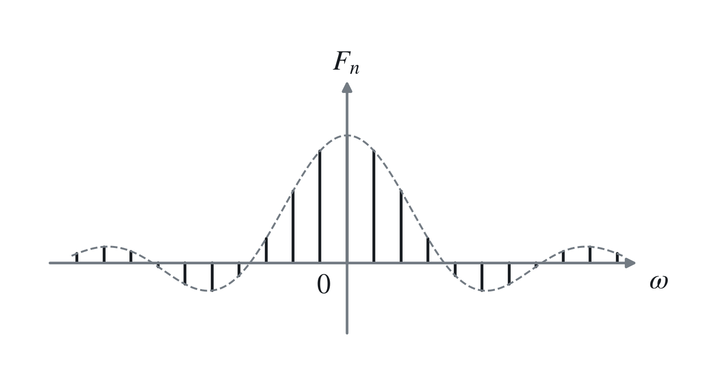

### （4）周期信号的功率分配

功率信号 $f(t)$ 的帕斯瓦尔公式：

$$
P=\frac1{T_1}\int_{-T_1/2}^{T_1/2}|f(t)|^2\,\mathrm dt
=c_0^2+\frac12\sum_{n=1}^{\infty}c_n^2
=\sum_{n=-\infty}^{+\infty}|F_n|^2.
$$

（时域和频域的能量守恒。）

### （5）函数的对称性与傅里叶系数的关系

#### ① 偶函数

$$
a_0=\frac1{T_1}\int_{-T_1/2}^{T_1/2}f(t)\,\mathrm dt,
\quad
a_n=\frac4{T_1}\int_0^{T_1/2}f(t)\cos(n\omega_1t)\,\mathrm dt,
\quad b_n=0.
$$

$$
{\color{#c62828}
c_n=a_n=2F_n,\qquad F_n=F_{-n}=\frac{a_n}{2},
\qquad\varphi_n=0\text{ 或 }\pi
}.
$$

（由于 $F_n$ 为实数。）

#### ② 奇函数

$$
a_0=a_n=0,\qquad
b_n=\frac4{T_1}\int_0^{T_1/2}f(t)\sin(n\omega_1t)\,\mathrm dt.
$$

$$
{\color{#c62828}
c_n=b_n,\qquad F_n=-F_{-n}=-j\frac{b_n}{2},
\qquad\varphi_n=-\frac\pi2\text{ 或 }\frac\pi2
}.
$$

#### ③ 奇谐函数（半波对称函数）

$$
f(t)=-f\left(t\pm\frac{T_1}{2}\right).
$$

$$
a_0=0,\qquad a_n=b_n=0\quad(n\text{ 为偶数}).
$$

对于奇数 $n$，

$$
a_n=\frac4{T_1}\int_0^{T_1/2}f(t)\cos(n\omega_1t)\,\mathrm dt,
\qquad
b_n=\frac4{T_1}\int_0^{T_1/2}f(t)\sin(n\omega_1t)\,\mathrm dt.
$$

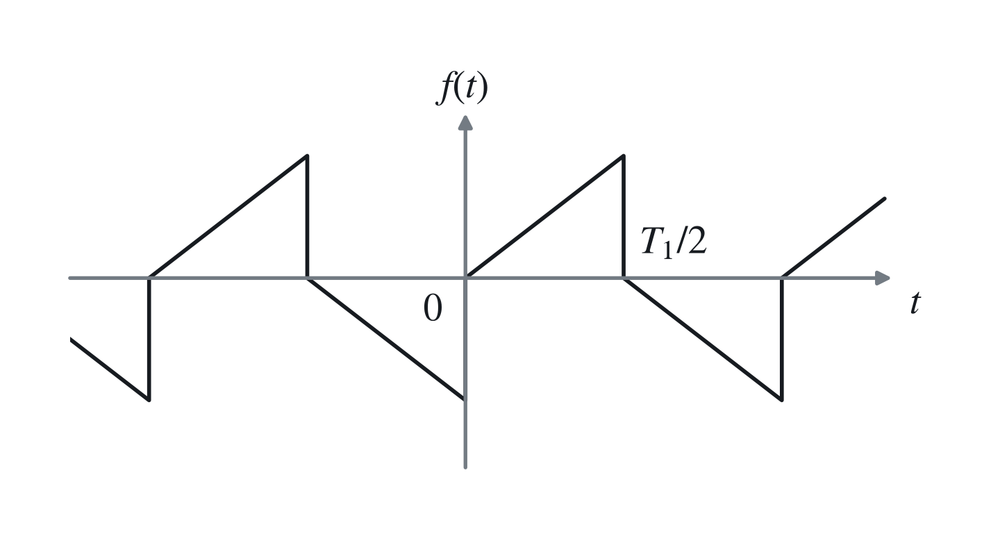

### （6）周期矩形脉冲信号

脉冲宽度 $\tau$，幅度 $E$，重复周期 $T_1$。在一个周期内：

$$
f(t)=E\left[u\left(t+\frac\tau2\right)-u\left(t-\frac\tau2\right)\right],
\qquad
t\in\left[-\frac{T_1}{2},\frac{T_1}{2}\right],
\quad0<\tau<T_1.
$$

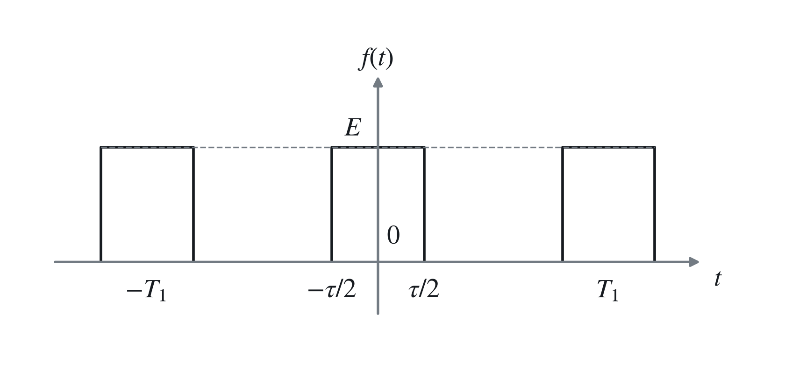

三角形式：

$$
f(t)=c_0+\sum_{n=1}^{\infty}c_n\cos(n\omega_1t),
\qquad \omega_1=\frac{2\pi}{T_1},
$$

$$
a_0=\frac{E\tau}{T_1},\qquad
{\color{#c62828}a_n=\frac{E\tau\omega_1}{\pi}
\operatorname{Sa}\left(\frac{n\omega_1\tau}{2}\right)}.
$$

$$
{\color{#c62828}\operatorname{Sa}(x)=\frac{\sin x}{x}},
$$

为取样函数，且

$$
\int_{-\infty}^{+\infty}\operatorname{Sa}(x)\,\mathrm dx=\pi.
$$

$c_n=a_n$。

指数形式：

$$
f(t)=\sum_{n=-\infty}^{+\infty}F_ne^{jn\omega_1t},
\qquad
F_n=\frac{a_n}{2}=\frac{E\tau}{T_1}\operatorname{Sa}\left(\frac{n\omega_1\tau}{2}\right).
$$

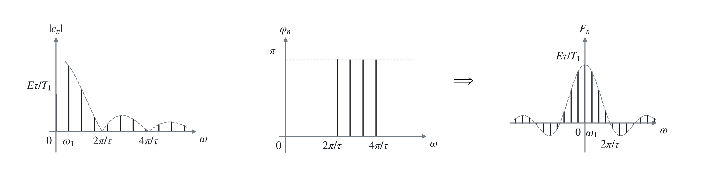

频谱特征：

1. 谱线离散，间隔为 $\omega_1=2\pi/T_1$。
2. 各分量大小正比于 $E$ 和 $\tau$，反比于 $T_1$；直流分量峰值为 $E\tau/T_1$。
3. 谱线按 $\operatorname{Sa}(\omega\tau/2)$（$\omega=n\omega_1$）的包络规律变化。当 <strong>$\omega=2m\pi/\tau$</strong>，$m=\pm1,\pm2,\ldots$ 时，包络过零。
4. <strong>频带宽度（带宽）</strong>： $B_\omega=2\pi/\tau$ 或 $B_f=1/\tau$，只与脉宽有关，成反比。
5. 谱线呈减小趋势，较高幅值谱线集中在第一个过零点 $\omega=2\pi/\tau$ 内，可舍弃 $\omega>2\pi/\tau$ 分量。

### （7）对称方波信号

取 $\tau=T_1/2$，

$$
\bar f(t)=f(t)-\frac E2,
$$

即周期矩形脉冲向下平移。

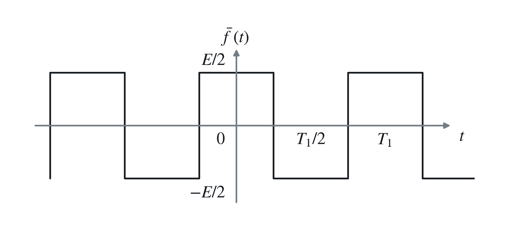

三角形式：

$$
\bar f(t)=c_0+\sum_{n=1}^{\infty}c_n\cos(n\omega_1t),
\qquad c_0=0,\qquad c_n=E\operatorname{Sa}\left(\frac{n\pi}{2}\right).
$$

指数形式：

$$
\bar f(t)=\sum_{n=-\infty}^{+\infty}\bar F_ne^{jn\omega_1t}.
$$

$$
\begin{aligned}
\bar F_n
&=\frac1{T_1}\int_{-T_1/2}^{T_1/2}\bar f(t)e^{-jn\omega_1t}\,\mathrm dt\\
&=\frac1{T_1}\int_{-T_1/2}^{T_1/2}
\left(f(t)-\frac E2\right)e^{-jn\omega_1t}\,\mathrm dt\\
&=\frac1{T_1}\int_{-T_1/2}^{T_1/2}f(t)e^{-jn\omega_1t}\,\mathrm dt
\quad\text{（由 1 与 }e^{jn\omega_1t}\text{ 正交）}\\
&=F_n.
\end{aligned}
$$

与周期矩形脉冲相同。

### （8）复指数信号

$$
f(t)=e^{j\omega_1t}.
$$

$$
\begin{aligned}
F_n
&=F(n\omega_1)=\frac1{T_1}\int_{-T_1/2}^{T_1/2}e^{j\omega_1t}e^{-jn\omega_1t}\,\mathrm dt\\
&=\frac{e^{j(1-n)\pi}-e^{-j(1-n)\pi}}{2\pi j(1-n)}\\
&=\operatorname{Sa}((1-n)\pi)
={\color{#c62828}\begin{cases}1,&n=1,\\0,&n\neq1.\end{cases}}
\end{aligned}
$$

$F_n=|F_n|e^{j\varphi_n}=1\cdot e^{j\varphi_n}=1$，故 $\varphi_n=0$。仅在 $\omega_1$ 处有幅度为 $1$ 的分量，为正弦信号的一种表现形式。

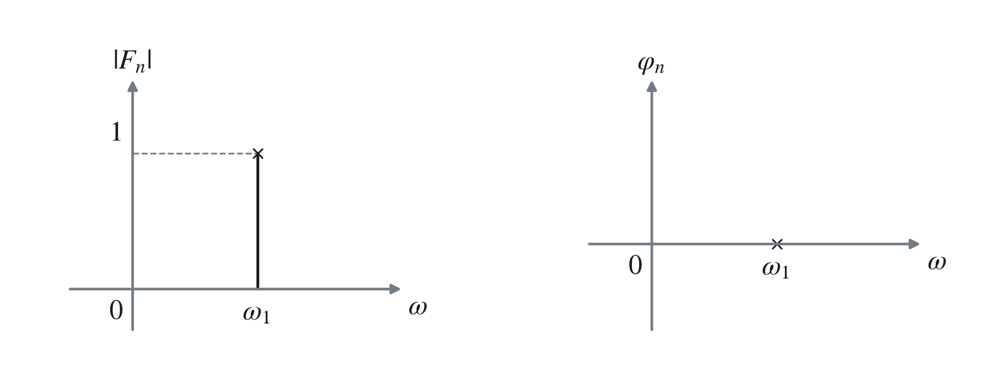

### （9）正弦信号的频谱

$$
\cos\omega_1t=\frac12(e^{j\omega_1t}+e^{-j\omega_1t}),
$$

$$
\sin\omega_1t=\frac1{2j}(e^{j\omega_1t}-e^{-j\omega_1t}).
$$

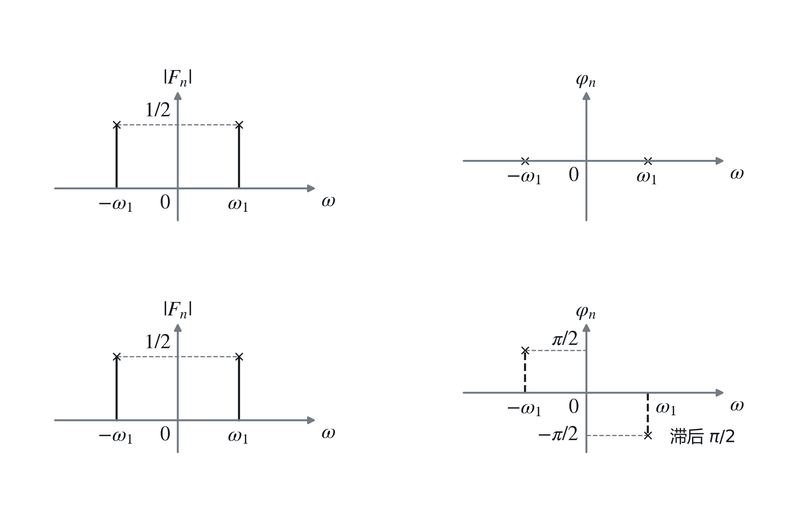

### （10）非周期信号的傅里叶变换

将非周期信号 $f(t)$ 以周期 $T_1$ 进行周期延拓，得到 $\hat f(t)$。Fourier 级数展开得

$$
\hat f(t)=\sum_{n=-\infty}^{+\infty}\hat F_ne^{jn\omega_1t},
\qquad
\hat F_n=\frac1{T_1}\int_{-T_1/2}^{T_1/2}f(t)e^{-jn\omega_1t}\,\mathrm dt.
$$

当 $T_1\to\infty$ 时，$\hat f(t)\to f(t)$，谱线间隔 $\omega_1=2\pi/T_1\to0$。单条级数系数 $\hat F_n$ 趋于 $0$，故定义连续频谱密度，使

$$
{\color{#c62828}F(n\omega_1)=T_1\hat F_n}.
$$

令 $n\omega_1\to\omega$，则

$$
{\color{#c62828}
F(\omega)=\lim_{T_1\to\infty}
\int_{-T_1/2}^{T_1/2}f(t)e^{-j\omega t}\,\mathrm dt
=\int_{-\infty}^{+\infty}f(t)e^{-j\omega t}\,\mathrm dt
}.
$$

<strong>$F(\omega)$ 即频谱密度函数</strong>，将离散频谱转换为连续频谱。

基于 $F(\omega)$：

$$
\begin{aligned}
f(t)
&=\lim_{T_1\to\infty}\hat f(t)
=\lim_{T_1\to\infty}\sum_{n=-\infty}^{+\infty}\hat F_ne^{jn\omega_1t}\\
&=\lim_{T_1\to\infty}\sum_{n=-\infty}^{+\infty}
T_1\hat F_ne^{jn\omega_1t}\frac1{T_1}\\
&=\lim_{\omega_1\to0}\sum_{n=-\infty}^{+\infty}
F(n\omega_1)e^{jn\omega_1t}\frac{\omega_1}{2\pi}\\
&=\frac1{2\pi}\int_{-\infty}^{+\infty}F(\omega)e^{j\omega t}\,\mathrm d\omega.
\end{aligned}
$$

<strong>傅里叶变换对：</strong>

$$
f(t)\xleftrightarrow{\mathcal F}F(\omega),
$$

$$
F(\omega)=\mathcal F[f(t)]
=\int_{-\infty}^{+\infty}f(t)e^{-j\omega t}\,\mathrm dt,
\qquad
f(t)=\mathcal F^{-1}[F(\omega)]
=\frac1{2\pi}\int_{-\infty}^{+\infty}F(\omega)e^{j\omega t}\,\mathrm d\omega.
$$

频谱密度函数

$$
F(\omega)=|F(\omega)|e^{j\varphi(\omega)}.
$$

傅里叶反变换的三角形式：

$$
f(t)=\frac1{2\pi}\int_{-\infty}^{+\infty}F(\omega)e^{j\omega t}\,\mathrm d\omega
=\frac1{2\pi}\int_{-\infty}^{+\infty}
|F(\omega)|e^{j(\omega t+\varphi(\omega))}\,\mathrm d\omega.
$$

由于 $|F(\omega)|$ 为偶函数，$\varphi(\omega)$ 为奇函数，得 $|F(\omega)|\sin(\omega t+\varphi(\omega))$ 为奇函数（若 $f(t)$ 为实函数），故

$$
f(t)=\frac1{2\pi}\int_{-\infty}^{+\infty}
|F(\omega)|\cos(\omega t+\varphi(\omega))\,\mathrm d\omega
=\frac1\pi\int_0^\infty
|F(\omega)|\cos(\omega t+\varphi(\omega))\,\mathrm d\omega.
$$

狄里赫利条件：

1. $f(t)$ 在<strong>无限区间内</strong>绝对可积，即 $\int_{-\infty}^{+\infty}|f(t)|\,\mathrm dt<\infty$。
2. 在任意有限区间内，只有有限个不连续点，在这些点上函数取有限值。
3. 在任意有限区间内，只有有限个极大值和极小值。

这些是充分条件。

### （11）典型非周期信号的频谱

#### ① 矩形脉冲信号（窗函数、门函数）

$$
f(t)=\begin{cases}E,&|t|<\tau/2,\\0,&|t|>\tau/2.\end{cases}
$$

由 Fourier 变换定义得

$$
{\color{#c62828}F(\omega)=E\tau\operatorname{Sa}\left(\frac{\omega\tau}{2}\right)}.
$$

与相同宽度的周期矩形离散谱 $F_n$ 相比，包络形状相同，幅度尺度不同：分别为 $E\tau/T_1$ 与 $E\tau$。

#### ② 单边指数信号

$$
f(t)=\begin{cases}e^{-at},&t>0,\ a>0,\\0,&t<0,\end{cases}
\qquad
{\color{#c62828}F(\omega)=\frac1{a+j\omega}}.
$$

$$
|F(\omega)|=\frac1{\sqrt{a^2+\omega^2}},
\qquad
\varphi(\omega)=-\arctan\frac\omega a.
$$

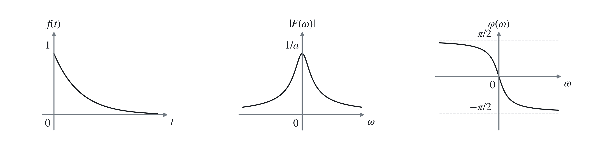

#### ③ 双边指数信号

$$
f(t)=e^{-a|t|},\qquad a>0,
$$

$$
F(\omega)=\frac1{a-j\omega}+\frac1{a+j\omega}
=\frac{2a}{a^2+\omega^2},
$$

$$
|F(\omega)|=\frac{2a}{a^2+\omega^2},
\qquad\varphi(\omega)=0.
$$

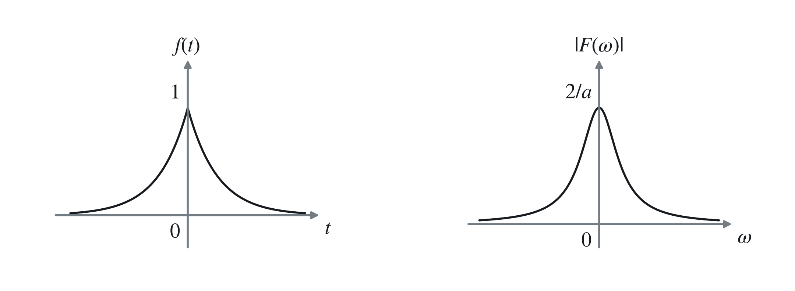

#### ④ 直流信号

$f(t)=1$，$-\infty<t<+\infty$，不满足狄里赫利条件，但可通过 $e^{-a|t|}$ 的极限求得。

$$
F(\omega)=\lim_{a\to0^+}\frac{2a}{a^2+\omega^2}
=\begin{cases}0,&\omega\neq0,\\\infty,&\omega=0.\end{cases}
$$

（冲激函数。）当 $\omega=0$ 时：

$$
\begin{aligned}
\lim_{a\to0^+}\int_{-\infty}^{+\infty}\frac{2a}{a^2+\omega^2}\,\mathrm d\omega
&=\lim_{a\to0^+}\int_{-\infty}^{+\infty}
\frac2{1+(\omega/a)^2}\,\mathrm d(\omega/a)\\
&=\lim_{a\to0^+}\left.2\arctan\frac\omega a\right|_{-\infty}^{+\infty}
=2\pi.
\end{aligned}
$$

因此

$$
{\color{#c62828}f(t)=\lim_{a\to0^+}e^{-a|t|}=1,
\qquad F(\omega)=2\pi\delta(\omega)}.
$$

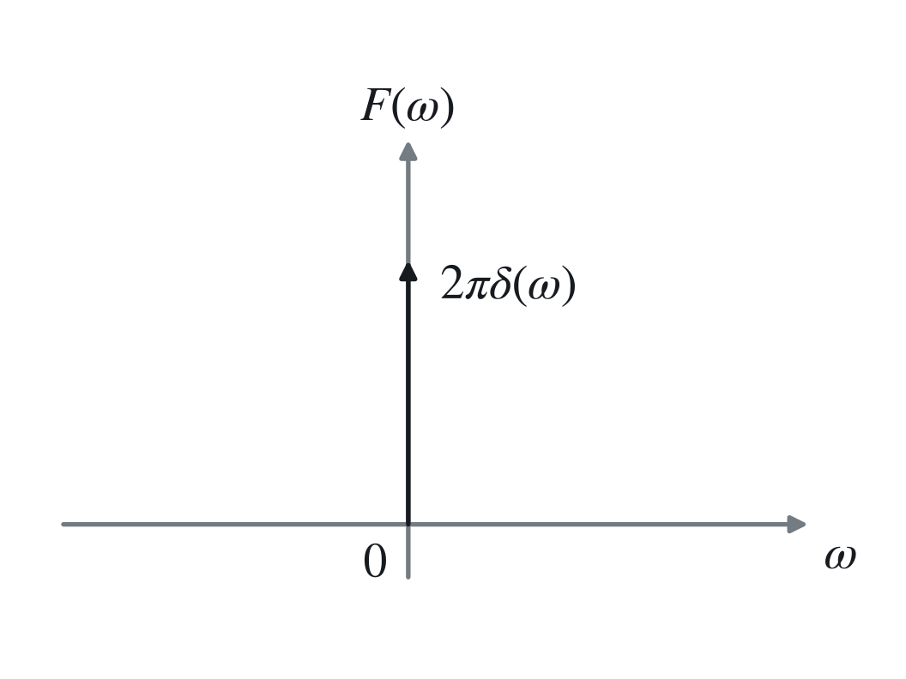

#### ⑤ 双边奇指数信号

$$
f(t)=\begin{cases}-e^{at},&t<0,\\e^{-at},&t>0,\end{cases}
\qquad a>0.
$$

$$
F(\omega)=-\frac{j\,2\omega}{a^2+\omega^2},
\qquad
|F(\omega)|=\frac{2|\omega|}{a^2+\omega^2},
$$

$$
\varphi(\omega)=
\begin{cases}\pi/2,&\omega<0,\\-\pi/2,&\omega>0.\end{cases}
$$

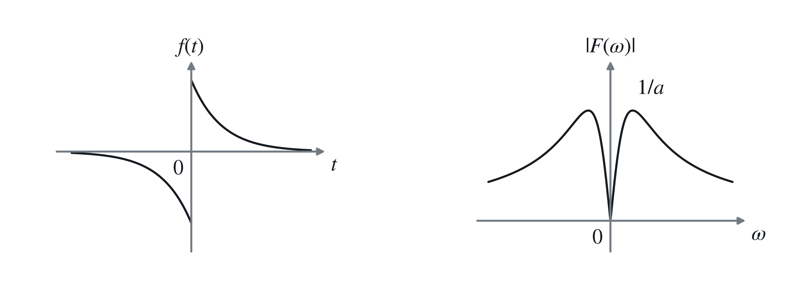

#### ⑥ 符号函数信号

$$
\operatorname{sgn}(t)=
\begin{cases}-1,&t<0,\\0,&t=0,\\1,&t>0.\end{cases}
$$

不满足绝对可积，但可通过双边奇指数信号的极限求得：

$$
F(\omega)=\lim_{a\to0^+}-\frac{j\,2\omega}{a^2+\omega^2}
={\color{#c62828}\frac2{j\omega}}.
$$

$$
|F(\omega)|=\frac2{|\omega|},
\qquad
\varphi(\omega)=\begin{cases}\pi/2,&\omega<0,\\-\pi/2,&\omega>0.\end{cases}
$$

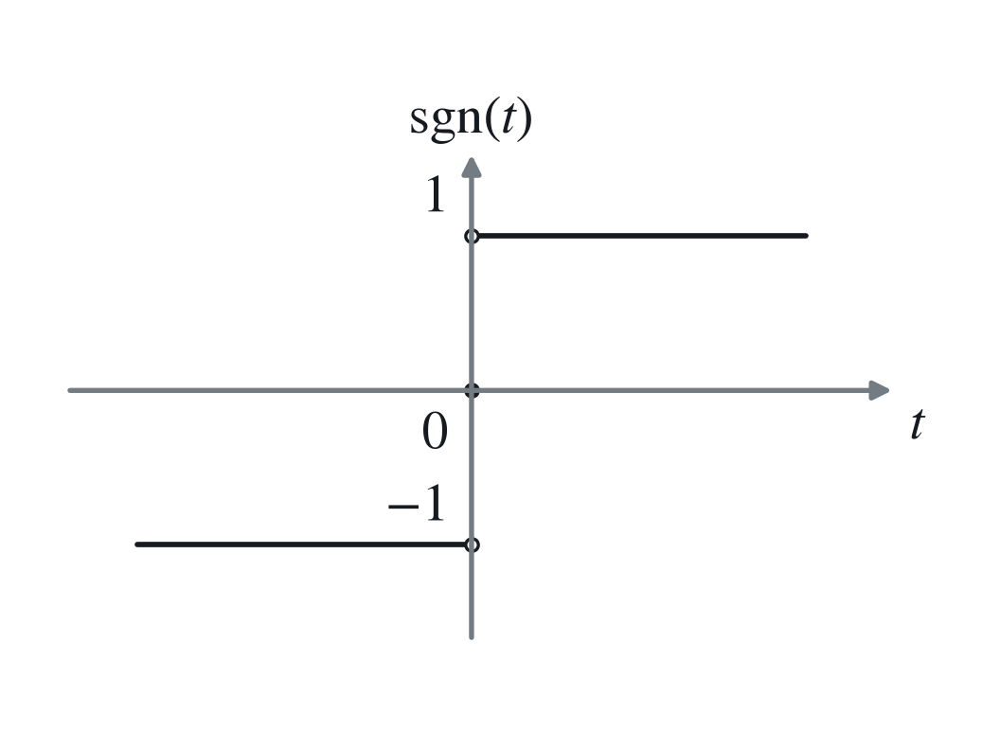

### （12）常见奇异信号的频谱

#### ① 单位冲激信号

$$
{\color{#c62828}F(\omega)=\mathcal F[\delta(t)]=1}.
$$

频谱占据整个频率域，呈均匀分布。

由 $\mathcal F[1]=2\pi\delta(\omega)$，得

$$
{\color{#c62828}\mathcal F^{-1}[\delta(\omega)]=\frac1{2\pi}}.
$$

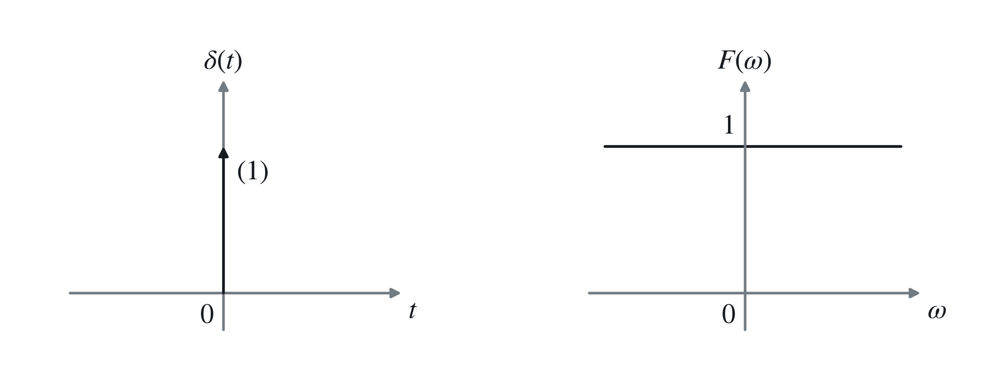

#### ② 单位阶跃信号

$$
u(t)=\frac12+\frac12\operatorname{sgn}(t),
$$

$$
{\color{#c62828}F(\omega)=\mathcal F[u(t)]
=\pi\delta(\omega)+\frac1{j\omega}}.
$$

$u(t)$ 含有直流分量，频谱中存在冲激函数。

### （13）傅里叶变换的性质

#### ① 线性

满足叠加定理。

#### ② 奇偶虚实性

$$
f(t)\xleftrightarrow{\mathcal F}F(\omega)
\quad\Rightarrow\quad
f^*(t)\xleftrightarrow{\mathcal F}F^*(-\omega).
$$

当 $f(t)$ 为实函数时，$F(\omega)=F^*(-\omega)$。

幅度谱为 $\omega$ 的<strong>偶函数</strong>，$\varphi(\omega)$ 是 $\omega$ 的<strong>奇函数</strong>。

$f(t)$ 为实偶函数，则 $F(\omega)$ 为实偶函数；$f(t)$ 为实奇函数，则 $F(\omega)$ 为虚奇函数。

#### ③ 对偶性

$$
{\color{#c62828}
f(t)\xleftrightarrow{\mathcal F}F(\omega)
\quad\Rightarrow\quad
F(t)\xleftrightarrow{\mathcal F}2\pi f(-\omega)
}.
$$

例：由窗函数 $\mathcal F[f(t)]=E\tau\operatorname{Sa}(\omega\tau/2)$，取 $E=2$、$\tau=1/2$，得

$$
\mathcal F[\operatorname{Sa}(t)]=2\pi f(-\omega)
=\begin{cases}\pi,&|\omega|<1,\\0,&|\omega|>1.\end{cases}
$$

> 由对偶性易得：
>
> $$
> \mathcal F[\operatorname{Sa}(t)]
> =\begin{cases}\pi,&|\omega|<1,\\0,&|\omega|>1.\end{cases}
> $$
>
> $$
> \mathcal F[\operatorname{Sa}(kt)]
> =\begin{cases}\pi/k,&|\omega|<k,\\0,&|\omega|>k.\end{cases}
> $$

#### ④ 尺度变换特性

$$
{\color{#c62828}
f(t)\xleftrightarrow{\mathcal F}F(\omega)
\quad\Rightarrow\quad
f(at)\xleftrightarrow{\mathcal F}\frac1{|a|}F\left(\frac\omega a\right)
},\qquad a\in\mathbb R.
$$

信号波形在时域压缩／扩展，对应频域的扩展／压缩。特别地，$a=-1$ 时

$$
f(-t)\xleftrightarrow{\mathcal F}F(-\omega),
$$

二者均翻转。

#### ⑤ 时移特性

$$
{\color{#c62828}
f(t\pm t_0)\xleftrightarrow{\mathcal F}e^{\pm j\omega t_0}F(\omega)
}.
$$

信号的频谱幅度不变，相位频谱产生 $-\omega t_0$ 或 $+\omega t_0$ 的变化。

#### ⑥ 频移特性

$$
{\color{#c62828}
f(t)e^{\pm j\omega_0t}\xleftrightarrow{\mathcal F}F(\omega\mp\omega_0)
}.
$$

频谱搬移：将频谱右移／左移。

$$
\mathcal F[f(t)\cos\omega_0t]
=\frac12F(\omega-\omega_0)+\frac12F(\omega+\omega_0).
$$

正弦同理。

#### ⑦ 微分特性

$$
{\color{#c62828}
\frac{\mathrm d^nf(t)}{\mathrm dt^n}
\xleftrightarrow{\mathcal F}(j\omega)^nF(\omega)
}.
$$

对 Fourier 反变换求导易证。增强高频成分，有助于突出信号变化。

#### ⑧ 积分特性

$$
{\color{#c62828}
\int_{-\infty}^{t}f(\tau)\,\mathrm d\tau
\xleftrightarrow{\mathcal F}
\frac1{j\omega}F(\omega)+\pi F(0)\delta(\omega)
}.
$$

能削弱高频成分，有助于平滑信号变化。

证明：

$$
\begin{aligned}
\mathcal F\left[\int_{-\infty}^{t}f(\tau)\,\mathrm d\tau\right]
&=\int_{-\infty}^{+\infty}
\left[\int_{-\infty}^{t}f(\tau)\,\mathrm d\tau\right]e^{-j\omega t}\,\mathrm dt\\
&=\int_{-\infty}^{+\infty}
\left[\int_{-\infty}^{+\infty}f(\tau)u(t-\tau)\,\mathrm d\tau\right]
e^{-j\omega t}\,\mathrm dt\\
&=\int_{-\infty}^{+\infty}f(\tau)
\left[\int_{-\infty}^{+\infty}u(t-\tau)e^{-j\omega t}\,\mathrm dt\right]
\,\mathrm d\tau\\
&=\int_{-\infty}^{+\infty}f(\tau)\pi\delta(\omega)e^{-j\omega\tau}\,\mathrm d\tau
+\int_{-\infty}^{+\infty}f(\tau)\frac{e^{-j\omega\tau}}{j\omega}\,\mathrm d\tau\\
&=\pi F(0)\delta(\omega)+\frac1{j\omega}F(\omega).
\end{aligned}
$$

#### ⑨ 卷积特性

时域卷积定理：若 $f_1\leftrightarrow F_1$、$f_2\leftrightarrow F_2$，则

$$
{\color{#c62828}f_1(t)*f_2(t)
\xleftrightarrow{\mathcal F}F_1(\omega)F_2(\omega)}.
$$

频域卷积定理：

$$
{\color{#c62828}f_1(t)f_2(t)
\xleftrightarrow{\mathcal F}\frac1{2\pi}F_1(\omega)*F_2(\omega)}.
$$

### （14）周期信号的傅里叶变换

#### ① 复指数信号

由 $\mathcal F[f(t)e^{j\omega_0t}]=F(\omega-\omega_0)$、$\mathcal F[1]=2\pi\delta(\omega)$，令 $f(t)=1$，即得

$$
{\color{#c62828}\mathcal F[e^{j\omega_0t}]=2\pi\delta(\omega-\omega_0)}.
$$

#### ② 正弦与余弦信号

由 Euler 公式：

$$
{\color{#c62828}
\mathcal F[\sin\omega_0t]
=-j\pi\delta(\omega-\omega_0)+j\pi\delta(\omega+\omega_0)
},
$$

$$
{\color{#c62828}
\mathcal F[\cos\omega_0t]
=\pi\delta(\omega-\omega_0)+\pi\delta(\omega+\omega_0)
}.
$$

求单周期正弦的 Fourier 变换时，可以加窗
$u(t+T/2)-u(t-T/2)$，再用频域卷积定理。

#### ③ 一般周期信号

其<strong>傅里叶级数</strong>为指数形式

$$
{\color{#c62828}f(t)=\sum_{n=-\infty}^{+\infty}F_ne^{jn\omega_1t}}.
$$

则其<strong>傅里叶变换</strong>为

$$
{\color{#c62828}F(\omega)
=\sum_{n=-\infty}^{+\infty}2\pi F_n\delta(\omega-n\omega_1)}.
$$

## 5. 连续信号的复频域分析

### （1）从 Fourier 变换到 Laplace 变换

扩大频谱分析的范围。

$f(t)=e^{at}$（$a>0$）不满足绝对可积，需乘一个随时间衰减的因子 $e^{-\sigma t}$，则

$$
\mathcal F[e^{at}e^{-\sigma t}]
=\int_{-\infty}^{+\infty}e^{at}e^{-(\sigma+j\omega)t}\,\mathrm dt.
$$

记 $s=\sigma+j\omega$，则有

$$
\int_{-\infty}^{+\infty}e^{at}e^{-(\sigma+j\omega)t}\,\mathrm dt
=\int_{-\infty}^{+\infty}f(t)e^{-st}\,\mathrm dt
\triangleq F_b(s).
$$

<strong>双边 Laplace 变换对：</strong>

$$
{\color{#c62828}f(t)\xleftrightarrow{\mathcal L_b}F_b(s)},
$$

$$
{\color{#c62828}
\begin{cases}
F_b(s)=\displaystyle\int_{-\infty}^{+\infty}f(t)e^{-st}\,\mathrm dt,\\
f(t)=\displaystyle\frac1{2\pi j}\int_{\sigma-j\infty}^{\sigma+j\infty}F_b(s)e^{st}\,\mathrm ds.
\end{cases}
}
$$

$f(t)$ 是 $e^{st}$（$s=\sigma+j\omega$）的线性组合，$\sigma>0$ 增幅振荡，$\sigma<0$ 减幅振荡，$\sigma=0$ 时 $F_b(s)=F(\omega)$。

### （2）Laplace 变换的收敛域

为使 $e^{at}$ 乘衰减因子 $e^{-\sigma t}$ 后收敛，必有 $\sigma>a$。

若 $\lim_{t\to\infty}f(t)e^{-\sigma t}=0$（$\sigma>\sigma_0$），则此时 $f(t)e^{-\sigma t}$ 在 $\sigma>\sigma_0$ 的范围全部收敛。

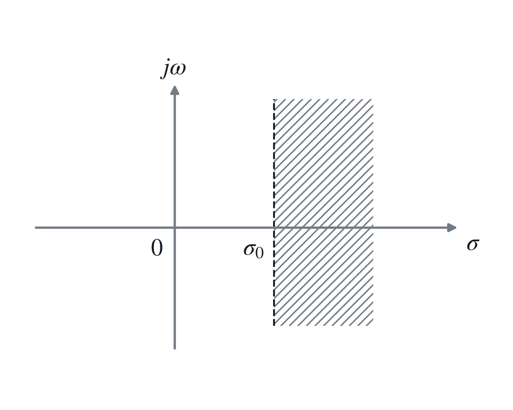

有 Laplace 变换不一定有 Fourier 变换，有 Fourier 变换一般均有 Laplace 变换（除直流 $f(t)=1$ 外）。

### （3）由 Laplace 变换求 Fourier 变换

$\sigma_0>0$ 时不存在，$\sigma_0<0$ 时令 $s=j\omega$ 即可。

$\sigma_0=0$ 时，若虚轴上有 $N$ 个极点，

$$
F_b(s)=F_{b1}(s)+\sum_{i=1}^{N}\frac{K_i}{s-j\omega_i},
$$

则

$$
\mathcal F[f(t)]=\left.F_b(s)\right|_{s=j\omega}
+\sum_{i=1}^{N}K_i\pi\delta(\omega-\omega_i).
$$
