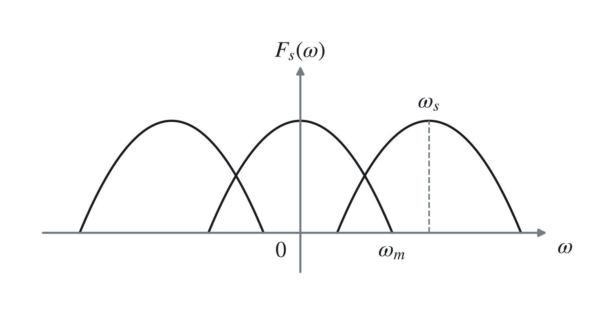
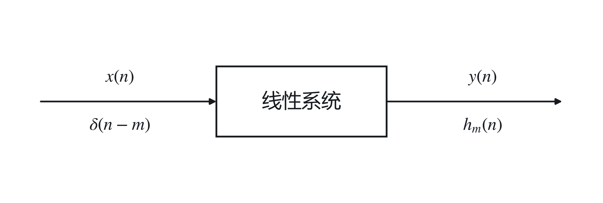
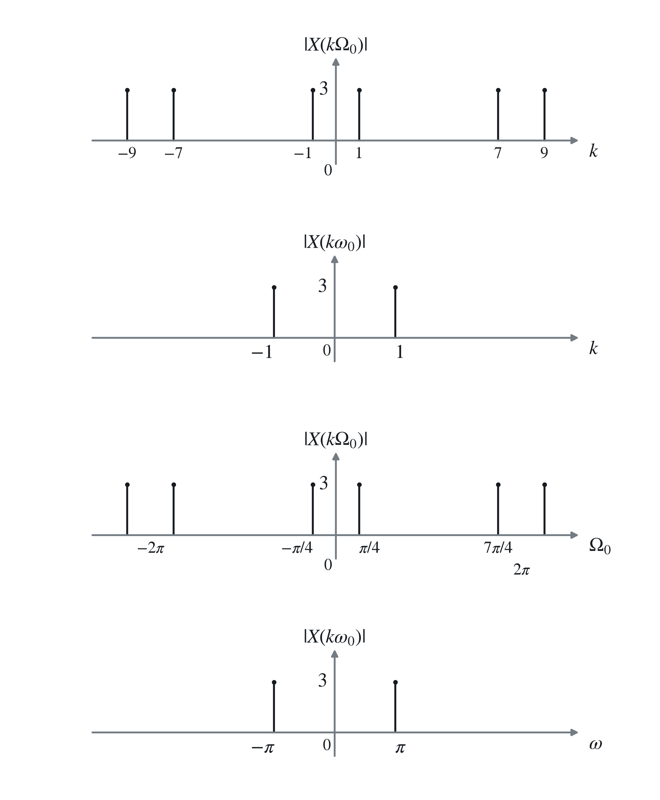
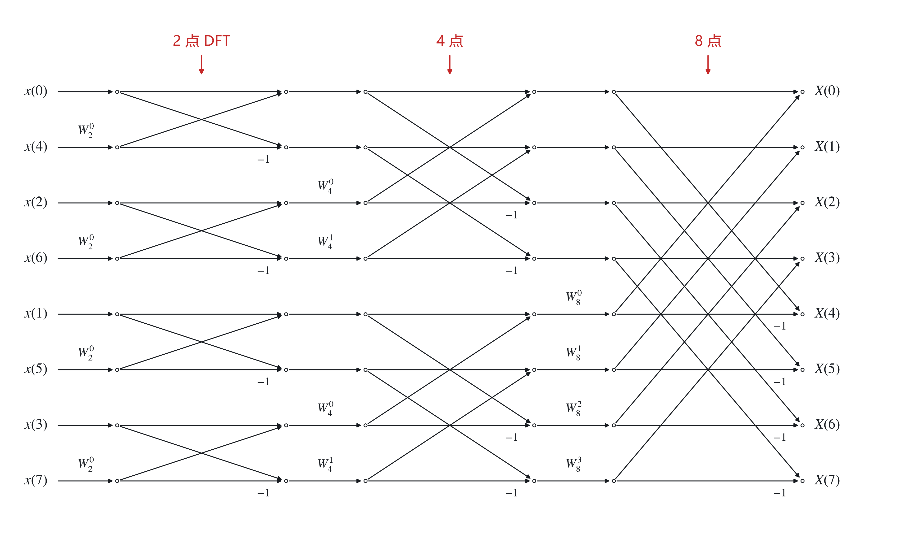

# 三、离散信号的分析

## 1. 信号的采样与恢复

### （1）时域采样

记采样周期为 $T_s$，则采样角频率 $\omega_s=2\pi/T_s$。

$$
{\color{#c62828}f_s(t)=f(t)p(t)},\qquad
F(\omega)=\mathcal F[f(t)],\qquad
F_s(\omega)=\mathcal F[f_s(t)].
$$

周期采样函数 $p(t)$ 的频谱为

$$
P(\omega)=\mathcal F[p(t)]
={\color{#c62828}\sum_{n=-\infty}^{+\infty}2\pi P_n\delta(\omega-n\omega_s)}.
$$

由频域卷积定理，

$$
{\color{#c62828}
F_s(\omega)=\frac1{2\pi}F(\omega)*P(\omega)
=\sum_{n=-\infty}^{+\infty}P_nF(\omega-n\omega_s)
}.
$$

这里用到 $F(\omega)*\delta(\omega-n\omega_s)=F(\omega-n\omega_s)$，$P_n$ 为傅里叶系数：

$$
P_n=\frac1{T_s}\int_{-T_s/2}^{T_s/2}p(t)e^{-jn\omega_st}\,\mathrm dt.
$$

### （2）矩形脉冲采样与冲激采样

若为矩形脉冲采样，则

$$
P_n=\frac{E\tau}{T_s}\operatorname{Sa}\left(\frac{n\omega_s\tau}{2}\right),
$$

$$
F_s(\omega)=\frac{E\tau}{T_s}\sum_{n=-\infty}^{+\infty}
\operatorname{Sa}\left(\frac{n\omega_s\tau}{2}\right)F(\omega-n\omega_s).
$$

$F(\omega)$ 以 $\omega_s$ 为周期进行延拓，幅度以 $\operatorname{Sa}\left(\frac{n\omega_s\tau}{2}\right)$ 为包络。

若为冲激（理想）采样，则

$$
{\color{#c62828}P_n=\frac1{T_s},\qquad
F_s(\omega)=\frac1{T_s}\sum_{n=-\infty}^{+\infty}F(\omega-n\omega_s)}.
$$

表明频谱发生<strong>周期延拓</strong>，拓展至以 $\pm\omega_s,\pm2\omega_s,\ldots$ 为中心的频谱，频谱幅度乘上 $1/T_s$ 因子。

### （3）<strong>时域采样定理</strong>

若 $x(t)$ 的频谱函数只在有限区间 $(-\omega_m,\omega_m)$ 具有有限值，则称为<strong>频谱受限的信号</strong>。

香农定理：对于频谱受限的信号 $x(t)$，若其最高频率分量为 $\omega_m$（$f_m$），为了保留原信号的全部信息，或能无失真地复原信号，采样频率应满足

$$
{\color{#c62828}\omega_s\geq2\omega_m\qquad(f_s\geq2f_m)}.
$$

将最低频率 $\omega_s=2\omega_m$ 称为<strong>奈奎斯特频率</strong>。

> 工程上一般取 $\omega_s\geq10\omega_m$。

（$\omega_s<2\omega_m$ 时频谱混叠。）

### （4）频域采样

记周期冲激序列

$$
\delta_T(t)=\sum_{k=-\infty}^{+\infty}\delta(t-kT_0),
\qquad
\mathcal F[\delta_T(t)]
=\omega_0\sum_{k=-\infty}^{+\infty}\delta(\omega-k\omega_0),
\quad\omega_0=\frac{2\pi}{T_0}.
$$

对 $F(\omega)$ 在频域上以 $\omega_0$ 为间隔采样，得到

$$
{\color{#c62828}F_p(\omega)=F(\omega)\delta_\omega(\omega)},
$$

$$
{\color{#c62828}
\delta_\omega(\omega)=\sum_{k=-\infty}^{+\infty}\delta(\omega-k\omega_0)
}=\frac1{\omega_0}\mathcal F[\delta_T(t)].
$$

由时域卷积定理，

$$
\begin{aligned}
{\color{#c62828}f_p(t)}
&={\color{#c62828}\mathcal F^{-1}[F_p(\omega)]
=f(t)*\mathcal F^{-1}[\delta_\omega(\omega)]}\\
&=f(t)*\frac1{\omega_0}\delta_T(t)
={\color{#c62828}\frac1{\omega_0}\sum_{k=-\infty}^{+\infty}f(t-kT_0)}.
\end{aligned}
$$

表明对应时域信号以 <strong>$T_0$ 为周期</strong>对原信号延拓，幅度乘以 $1/\omega_0$。

频域采样定理：若信号 $f(t)$ 为<strong>时间受限信号</strong>，集中在 $-t_m\sim+t_m$ 的时间范围内，若在频域以不大于<strong>$1/(2t_m)$ 的频率</strong>间隔对 $F(\omega)$ 采样，则采样后的频谱 $F_p(\omega)$ 可以唯一地表示原信号。

### （5）从时域采样信号恢复原信号

由于频域延拓，需取<strong>主频带（加窗）</strong>：

$$
{\color{#c62828}F(\omega)=F_s(\omega)H(\omega)}.
$$

$$
H(\omega)=\begin{cases}T_s,&|\omega|\leq\omega_c,\\0,&|\omega|>\omega_c.\end{cases}
$$

$$
h(t)=\mathcal F^{-1}[H(\omega)]
=\operatorname{Sa}\left(\frac{\omega_ct}{2}\right).
$$

于是

$$
f(t)=f_s(t)*h(t)
=\sum_{n=-\infty}^{+\infty}f(nT_s)
\operatorname{Sa}\left(\frac{\omega_s}{2}(t-nT_s)\right).
$$

这就是时域内插公式。只要 $f(t)$ 带限且满足采样定理，即可实现信号重建。

对非带限信号，采样前先用抗混叠滤波器，滤除高频成分。

### （6）从频域采样信号恢复原信号

需在时域加窗：

$$
{\color{#c62828}f(t)=f_p(t)g(t)},
$$

$$
g(t)=\begin{cases}\omega_0,&|t|\leq T_0/2,\\0,&|t|>T_0/2.\end{cases}
$$

故

$$
F(\omega)=\frac1{2\pi}F_p(\omega)*G(\omega)
=\sum_{k=-\infty}^{+\infty}F(k\omega_0)
\operatorname{Sa}\left(\frac{T_0}{2}(\omega-k\omega_0)\right).
$$

这是频域内插公式。

## 2. 离散信号的时域描述和运算

### （1）几种典型离散信号（序列）

#### 单位脉冲序列（单位样值信号）

$$
\delta(n)=\begin{cases}1,&n=0,\\0,&n\neq0,\end{cases}
\qquad \sum_{n=-\infty}^{+\infty}\delta(n)=1.
$$

也具有取样特性。

#### 单位阶跃序列

$$
u(n)=\begin{cases}1,&n\geq0,\\0,&n<0,\end{cases}
$$

$$
\delta(n)=u(n)-u(n-1),\qquad
u(n)=\sum_{k=0}^{\infty}\delta(n-k).
$$

#### 矩形序列

$$
R_N(n)=\begin{cases}1,&0\leq n\leq N-1,\\0,&\text{其他},\end{cases}
$$

$$
R_N(n)=u(n)-u(n-N)
=\delta(n)+\delta(n-1)+\cdots+\delta(n-(N-1)).
$$

#### 斜变序列

$$
R(n)=nu(n).
$$

$r(n)=n^2u(n)$。

#### 实指数序列（单边指数序列）

$$
x(n)=a^nu(n).
$$

#### 正弦型序列

$$
x(n)=A\sin(n\Omega_0+\varphi).
$$

其中 $\Omega_0$ 为数字角频率，$\varphi$ 为初始相角。

若由 $x(t)=A\sin\omega_0t$ 采样得到，$t=nT_s$，则

$$
x(n)=x(nT_s)=A\sin(n\omega_0T_s),
\qquad
\boxed{\color{#c62828}\Omega_0=\omega_0T_s=\frac{\omega_0}{f_s}}.
$$

与连续正弦信号的区别：

1. 连续：时移与相移一一对应。离散：时移 $\nRightarrow$ 相移（$\varphi\neq\varphi_0$，相移只有在 $\varphi_0$ 为 $\Omega_0$ 整数倍时才成立）。
2. 离散正弦不一定为周期性序列。
3. 两个相同的离散正弦信号，其 <strong>$\Omega_0$ 可能不相同</strong>（$\Omega_1=\Omega_2+2\pi$）。

#### 复指数序列

$$
x(n)=e^{(\sigma+j\Omega_0)n}
=e^{\sigma n}\bigl(\cos\Omega_0n+j\sin\Omega_0n\bigr).
$$

与正弦序列类似，作为 $\Omega_0$ 的函数以 $2\pi$ 为周期，故数字角频率有效范围可选 <strong>$[0,2\pi]$ 或 $[-\pi,\pi]$</strong>。

#### 任意离散序列

$$
x(n)=\sum_{m=-\infty}^{+\infty}x(m)\delta(n-m),
$$

即表示为加权、平移的脉冲信号之和。

### （2）离散信号的时域运算

① 平移：向右 $x(n-m)$，向左 $x(n+m)$；翻转：$x(-n)$。

② <strong>和：指同序号</strong>的序列值逐项相加：

$$
z(n)=x(n)+y(n).
$$

<strong>积：同序号</strong>序列值逐项相乘：

$$
z(n)=x(n)y(n).
$$

③ 累加：$x(n)$ 的累加序列为

$$
{\color{#c62828}y(n)=\sum_{k=-\infty}^{n}x(k)}.
$$

④ 差分运算：

$$
\text{前向差分：}\quad{\color{#c62828}\Delta x(n)=x(n+1)-x(n)},
$$

$$
\text{后向差分：}\quad{\color{#c62828}\nabla x(n)=x(n)-x(n-1)=\Delta x(n-1)}.
$$

⑤ 时间尺度变换：

$$
{\color{#c62828}x(n)\to x(mn),\ x(n/m)},\qquad m\in\mathbb Z_+.
$$

$x(mn)$ 表示采样频率降低 $m$ 倍，而 $x(n/m)$ 表示采样间隔减小，称为 $x(n)$ 的<strong>插值序列</strong>。

### （3）线性系统的单位脉冲响应

#### ① 一般线性系统

用 <strong>$h_m(n)$</strong> 表示离散时间线性系统对移位单位脉冲 <strong>$\delta(n-m)$</strong> 的响应。

由叠加性，

$$
x(n)=\sum_{m=-\infty}^{+\infty}x(m)\delta(n-m)
\quad\Rightarrow\quad
y(n)=\sum_{m=-\infty}^{+\infty}x(m)h_m(n).
$$

#### ② <strong>线性时不变（LTI）系统</strong>

有 $h_m(n)=h_0(n-m)$，即 $\delta(n)$ 移位，响应也随之移位。

令 <strong>$h(n)=h_0(n)$</strong>，则

$$
y(n)=\sum_{m=-\infty}^{+\infty}x(m)h(n-m)
={\color{#c62828}x(n)*h(n)}.
$$

> LTI 系统的单位脉冲响应完全刻画了系统特征。

#### ③ <strong>卷积和</strong>

对两序列 $x(n),y(n)$，定义

$$
z(n)=\sum_{m=-\infty}^{+\infty}x(m)y(n-m)=x(n)*y(n).
$$

计算步骤：

- 换坐标：将 $m$ 作为自变量，$n$ 作为参变量。
- 翻转：将 $y(m)$ 变为 $y(-m)$。
- 平移：计算 $z(n)$ 时，将 $y(-m)$ 向右平移 $n$，变为 $y(n-m)$。
- 最终相乘、累加。

<strong>长为 $N,M$ 的序列求卷积和后长度变为 $N+M-1$。</strong>

性质：

$$
x(n)*h(n)=h(n)*x(n),
$$

$$
x(n)*\bigl(h_1(n)+h_2(n)\bigr)=x(n)*h_1(n)+x(n)*h_2(n),
$$

$$
x(n)*\bigl(h_1(n)*h_2(n)\bigr)=\bigl(x(n)*h_1(n)\bigr)*h_2(n).
$$

与单位脉冲的卷积：

$$
{\color{#c62828}x(n-m)*\delta(n-k)=x(n-m-k)}.
$$

差分：

$$
\Delta\bigl(x(n)*y(n)\bigr)=x(n)*\bigl(\Delta y(n)\bigr)=\bigl(\Delta x(n)\bigr)*y(n).
$$

累加：

$$
\sum_{k=-\infty}^{n}(x*y)(k)
=x(n)*\left(\sum_{k=-\infty}^{n}y(k)\right)
=\left(\sum_{k=-\infty}^{n}x(k)\right)*y(n).
$$

## 3. 离散信号的频域分析

### （1）周期信号的频域分析

#### ① 推导<strong>离散傅里叶级数（DFS）</strong>

考虑连续周期信号的 Fourier 级数：

$$
f(t)=\sum_{n=-\infty}^{+\infty}F(n\omega_0)e^{jn\omega_0t}.
$$

将其记为

$$
x(t)=\sum_{k=-\infty}^{+\infty}X(k\omega_0)e^{jk\omega_0t}.
\tag{1}
$$

注意，$x(t)$ 为连续信号，周期为 $T_0=2\pi/\omega_0$。

Fourier 系数：

$$
X(k\omega_0)=X_k=\frac1{T_0}\int_0^{T_0}x(t)e^{-jk\omega_0t}\,\mathrm dt.
$$

对一个周期进行 <strong>$N$ 点采样</strong>，则有

$$
T_0=NT_s,\qquad\omega_0=\frac{2\pi}{NT_s},\qquad
\Omega_0=\omega_0T_s=\frac{2\pi}{N}.
$$

（注意，$k\Omega_0$ 为 $k$ 次谐波数字角频率，只有 $N$ 个分量：$k=1,2,\ldots,N$。）

采样后 $t=nT_s$，$\mathrm dt=T_s$，$X_k$ 变为

$$
\begin{aligned}
X\left(k\frac{\Omega_0}{T_s}\right)
&=\frac1{NT_s}\sum_{n=0}^{N-1}x(nT_s)e^{-jk\frac{2\pi}{NT_s}nT_s}T_s\\
&={\color{#c62828}\frac1N\sum_{n=0}^{N-1}x(nT_s)e^{-jk\Omega_0n}}.
\end{aligned}
$$

将 $x(t)$ 变为离散序列表示，则<strong>$x(nT_s)$ 变为 $x(n)$，$X(k\Omega_0/T_s)=X(k\Omega_0)$</strong>。故

$$
X_k=X(k\Omega_0)=\frac1N\sum_{n=0}^{N-1}x(n)e^{-jk\Omega_0n},
\qquad k=0,1,2,\ldots,N-1.
$$

由于 $X(k\Omega_0)$ 为变量 $k$ 的周期函数，故离散周期信号只有<strong>有限个谐波分量</strong>，谐波数 $k=2\pi/\Omega_0=N$，故式（1）的离散形式为

$$
{\color{#c62828}x(n)=\sum_{k=0}^{N-1}X(k\Omega_0)e^{jk\Omega_0n}},
\qquad n=0,1,\ldots,N-1.
$$

#### ② <strong>离散 Fourier 级数变换对</strong>

$$
{\color{#c62828}x(n)\xleftrightarrow{\mathrm{DFS}}X(k\Omega_0)}.
$$

正变换：

$$
X(k\Omega_0)=\frac1N\sum_{n\in\langle N\rangle}x(n)e^{-jk\Omega_0n}.
$$

反变换：

$$
x(n)=\sum_{k\in\langle N\rangle}X(k\Omega_0)e^{jk\Omega_0n}.
$$

$\langle N\rangle$ 表示任取长度为 $N$ 的一段。离散周期序列对应离散且周期的频谱：时域周期化，对应频域离散化。

> <strong>因此只有离散周期序列才能进行 DFS。</strong>

#### ③ 连续和离散周期信号频谱的关系

连续 Fourier 级数：

$$
x(t)\xleftrightarrow{\mathrm{CFS}}X(k\omega_0),
\qquad T_0,\quad \omega_0=\frac{2\pi}{T_0}.
$$

离散 Fourier 级数：

$$
x(n)\xleftrightarrow{\mathrm{DFS}}X(k\Omega_0),
\qquad N=\frac{T_0}{T_s},\quad {\color{#c62828}\Omega_0=\frac{2\pi}{N}}.
$$

<strong>满足采样定理</strong>的情况下，$X(k\Omega_0)$ 相当于 $X(k\omega_0)$ 作周期延拓，且频域上乘 $1/T_s$ 作线性变换。延拓周期为 $2\pi$（数字频率）或 $\omega_s=2\pi/T_s$（模拟频率）。

$X(k\Omega_0)$ 为具有谐波性的离散周期序列，$X(k\omega_0)$ 为具有谐波性的离散非周期序列。

$X(k\Omega_0)$ 可看作 $X(k\omega_0)$ 的近似式。

> 例：$x(t)=6\cos\pi t$，以 $T_s=0.25\,\mathrm s$ 采样，则
>
> $$
> \Omega_0=\frac\pi4,\qquad N=\frac{2\pi}{\Omega_0}=8.
> $$
>
> $$
> |X(k\Omega_0)|=\begin{cases}3,&k=\pm1,\pm7,\ldots,\\0,&\text{其他}.\end{cases}
> $$
>
> 而原信号幅度谱
>
> $$
> |X(k\omega_0)|=\begin{cases}3,&k=\pm1,\\0,&\text{其他}.\end{cases}
> $$
>
> 若用<strong>角频率</strong>作横坐标：
>
> 

#### ④ DFS 的主要性质

线性：

$$
ax(n)+by(n)\xleftrightarrow{\mathrm{DFS}}
aX(k\Omega_0)+bY(k\Omega_0).
$$

周期卷积定理：定义两<strong>周期序列</strong> $x(n),h(n)$ 的周期卷积

$$
x(n)\circledast h(n)
=\sum_{m=0}^{N-1}x(m)h(n-m)=h(n)\circledast x(n).
$$

则

$$
{\color{#c62828}
x\circledast h\xleftrightarrow{\mathrm{DFS}}NX(k\Omega_0)H(k\Omega_0)
},
$$

$$
{\color{#c62828}
x(n)h(n)\xleftrightarrow{\mathrm{DFS}}
X(k\Omega_0)\circledast H(k\Omega_0)
}.
$$

复共轭（$*$ 表共轭）：

$$
{\color{#c62828}x^*(-n)\xleftrightarrow{\mathrm{DFS}}X^*(k\Omega_0)}.
$$

位移性质：

$$
{\color{#c62828}
x(n-m)\xleftrightarrow{\mathrm{DFS}}e^{-jk\Omega_0m}X(k\Omega_0)
}.
$$

帕斯瓦尔定理：

$$
{\color{#c62828}
\frac1N\sum_{n=0}^{N-1}x(n)h^*(n)
=\sum_{k=0}^{N-1}X(k\Omega_0)H^*(k\Omega_0)
}.
$$

特别地，$x=h$ 时

$$
{\color{#c62828}
\frac1N\sum_{n=0}^{N-1}|x(n)|^2
=\sum_{k=0}^{N-1}|X(k\Omega_0)|^2
}.
$$

### （2）从 DFS 到<strong>离散时间傅里叶变换（DTFT）</strong>

#### ① 推导

将长度有限的非周期信号 $x(n)$ 以 $N$ 为周期延拓为周期信号 $x_N(n)$：

$$
X(k\Omega_0)=\frac1N\sum_{n\in\langle N\rangle}x(n)e^{-jk\Omega_0n}
=\frac1N\sum_{n\in\langle N\rangle}x(n)e^{-jk(2\pi/N)n}.
$$

当 $N\to\infty$ 时，$x_N(n)\to x(n)$，但 $X(k\Omega_0)\to0$。<strong>定义频谱密度函数：</strong>

$$
{\color{#c62828}
X(\Omega)=\lim_{N\to\infty}
NX(k\Omega_0)
=\sum_{n=-\infty}^{+\infty}x(n)e^{-j\Omega n}
}.
$$

此时

$$
\begin{aligned}
x(n)
&=\lim_{N\to\infty}x_N(n)=\lim_{N\to\infty}\sum_{k=0}^{N-1}X(k\Omega_0)e^{jk\Omega_0n}\\
&=\lim_{N\to\infty}\frac1N\sum_{k=0}^{N-1}
NX(k\Omega_0)e^{jk\Omega_0n}\\
&=\frac1{2\pi}\int_0^{2\pi}X(\Omega)e^{j\Omega n}\,\mathrm d\Omega.
\end{aligned}
$$

因为 <strong>$N\to\infty$ 时 $\Omega_0=2\pi/N\to\mathrm d\Omega$，$k\Omega_0\to\Omega$。</strong>

> $X(\Omega)$ 为周期函数：
>
> $$
> {\color{#c62828}X(\Omega+2\pi)=X(\Omega)}.
> $$
>
> 频谱可能混叠。

#### ② <strong>离散时间 Fourier 变换对</strong>

$$
{\color{#c62828}x(n)\xleftrightarrow{\mathrm{DTFT}}X(\Omega)}.
$$

正变换：序列 $x(n)$ 到频谱密度函数 $X(\Omega)$，也表示为 $X(e^{j\Omega})$：

$$
{\color{#c62828}
X(\Omega)=\sum_{n=-\infty}^{+\infty}x(n)e^{-j\Omega n}
}.
$$

反变换：

$$
{\color{#c62828}
x(n)=\frac1{2\pi}\int_0^{2\pi}X(\Omega)e^{j\Omega n}\,\mathrm d\Omega
=\frac1{2\pi}\int_{-\pi}^{\pi}X(\Omega)e^{j\Omega n}\,\mathrm d\Omega
}.
$$

DTFT 的存在条件：$x(n)$ 为无限长序列时，为确保和式收敛，要求 $x(n)$ 绝对可和或能量有限，即

$$
\sum_{n=-\infty}^{+\infty}|x(n)|<\infty
\quad\text{或}\quad
\sum_{n=-\infty}^{+\infty}|x(n)|^2<\infty.
$$

此时 $X(\Omega)$ 收敛。

> DTFT 对：
>
> $$
> x_1(n)=a^nu(n),\quad |a|<1
> \xleftrightarrow{\mathrm{DTFT}}
> X_1(\Omega)=\frac1{1-ae^{-j\Omega}}.
> $$
>
> $$
> x_2(n)=-a^nu(-n-1),\quad |a|>1
> \xleftrightarrow{\mathrm{DTFT}}
> X_2(\Omega)=\frac1{1-ae^{-j\Omega}}.
> $$
>
> 可用于求解线性常差分方程（两边取 DTFT）。

#### ③ DTFT 的性质

线性：

$$
ax(n)+by(n)\xleftrightarrow{\mathrm{DTFT}}aX(\Omega)+bY(\Omega).
$$

时域平移与频域平移：

$$
{\color{#c62828}
x(n-n_0)\xleftrightarrow{\mathrm{DTFT}}e^{-j\Omega n_0}X(\Omega)
},
$$

$$
{\color{#c62828}
e^{j\Omega_0n}x(n)\xleftrightarrow{\mathrm{DTFT}}X(\Omega-\Omega_0)
}.
$$

时域卷积：

$$
x(n)*y(n)\xleftrightarrow{\mathrm{DTFT}}X(\Omega)Y(\Omega).
$$

频域周期卷积：

$$
x(n)y(n)\xleftrightarrow{\mathrm{DTFT}}
\frac1{2\pi}\int_{-\pi}^{\pi}X(\lambda)Y(\Omega-\lambda)\,\mathrm d\lambda.
$$

共轭对称：

$$
x^*(n)\xleftrightarrow{\mathrm{DTFT}}X^*(-\Omega).
$$

频域微分：

$$
nx(n)\xleftrightarrow{\mathrm{DTFT}}j\frac{\mathrm dX(\Omega)}{\mathrm d\Omega}.
$$

#### ④ 与连续时间傅里叶变换（CTFT）的关系

均为时域非周期、频域连续，但 $X(\omega)$ 为非周期的，$X(\Omega)$ 为周期的。

### （3）从 DFS 到<strong>离散傅里叶变换（DFT）</strong>

#### ① 从周期延拓出发

将有限长序列 $x(n)$（$0\leq n\leq N-1$）按周期 $N$ 延拓：

$$
x_p(n)=\sum_{r\in\mathbb Z}x(n+rN).
$$

称 $x(n)$ 为主值序列，$x_p(n)$ 的 $0\leq n\leq N-1$ 为主值区间。

由 DFS 与 IDFS：

$$
X_p(k\Omega_0)=\frac1N\sum_{n=0}^{N-1}x_p(n)e^{-jk\Omega_0n},
\qquad k=0,1,\ldots,N-1,
$$

$$
x_p(n)=\sum_{k=0}^{N-1}X_p(k\Omega_0)e^{jk\Omega_0n},
\qquad n=0,1,\ldots,N-1.
$$

由系数周期性，可取 $0\leq k\leq N-1$ 为主值区间，主值内有

$$
X(k\Omega_0)=\frac1N\sum_{n=0}^{N-1}x(n)e^{-jk\Omega_0n},
\qquad k=0,1,\ldots,N-1,
$$

$$
x(n)=\sum_{k=0}^{N-1}X(k\Omega_0)e^{jk\Omega_0n},
\qquad n=0,1,\ldots,N-1.
$$

<strong>定义 $X(k)=NX(k\Omega_0)$，$\Omega_0=2\pi/N$。</strong>

$$
{\color{#c62828}
X(k)=\sum_{n=0}^{N-1}x(n)e^{-j(2\pi/N)kn}
},\qquad k=0,1,\ldots,N-1,
$$

$$
{\color{#c62828}
x(n)=\frac1N\sum_{k=0}^{N-1}X(k)e^{j(2\pi/N)kn}
},\qquad n=0,1,\ldots,N-1.
$$

即 DFT 与 IDFT。与 DTFT 不同，这里频域也离散化。

#### ② 从 DTFT 到 DFT

在主周期 $[-\pi,\pi]$ 内按采样间隔 $\Omega_0=2\pi/N$ 将连续频域函数 $X(\Omega)$ 离散化：

$$
X(k)=\left.X(\Omega)\right|_{\Omega=2\pi k/N}
=\operatorname{DFT}[x(n)].
$$

由频域采样定理，频域波形会以周期 $N$ 延拓，故时域样点数 $L$ 必须满足 $L\leq N$，通常 $L=N$。

### （4）<strong>DFT 的性质</strong>

#### ① 线性

$$
ax_1(n)+bx_2(n)\xleftrightarrow{\mathrm{DFT}}aX_1(k)+bX_2(k).
$$

#### ② <strong>圆周位移性质</strong>

$$
{\color{#c62828}
x((n-m)_N)R_N(n)\xleftrightarrow{\mathrm{DFT}}
X(k)e^{-jk\Omega_0m}
}.
$$

其中 $n-m\equiv((n-m))_N\pmod N$，$R_N(n)$ 为长度为 $N$ 的矩形序列。

同理，

$$
{\color{#c62828}
x(n)e^{jk_0\Omega_0n}\xleftrightarrow{\mathrm{DFT}}
X((k-k_0)_N)R_N(k)
}.
$$

#### ③ <strong>圆周卷积性质</strong>

<strong>$x(n),h(n)$ 均为长度 $N$ 的有限长序列。</strong>

时域圆周卷积：

$$
{\color{#c62828}
x(n)\circledast_Nh(n)\xleftrightarrow{\mathrm{DFT}}X(k)H(k)
}.
$$

定义：

$$
\begin{aligned}
x(n)\circledast_Nh(n)
&=\left[\sum_{m=0}^{N-1}x(m)h((n-m)_N)\right]R_N(n)\\
&=\left[\sum_{m=0}^{N-1}h(m)x((n-m)_N)\right]R_N(n).
\end{aligned}
$$

频域圆周卷积：

$$
{\color{#c62828}
x(n)h(n)\xleftrightarrow{\mathrm{DFT}}
\frac1N X(k)\circledast_NH(k)
}.
$$

与线性卷积的关系：

设有限长序列 $x(n),h(n)$ 长度分别为 $N,M$，记 $y(n)=x(n)*h(n)$，则 $y(n)$ 长度为 $N+M-1$。若 $x(n)$ 非零区间为 $0\leq n\leq N-1$，$h(n)$ 为 $0\leq n\leq M-1$，则将两序列补 $0$ 至长度 $L$。当

$$
{\color{#c62828}L\geq N+M-1}
$$

时，有

$$
{\color{#c62828}x(n)\circledast h(n)=x(n)*h(n)}.
$$

#### ④ 奇偶虚实性

- 实偶函数 $\to$ 实偶函数。
- 实奇函数 $\to$ 虚奇函数。
- 虚偶函数 $\to$ 虚偶函数。
- 虚奇函数 $\to$ 实奇函数。

## 4. 快速傅里叶变换及应用

### （1）DFT 的矩阵形式

$$
X(k)=\sum_{n=0}^{N-1}x(n)e^{-j(2\pi/N)nk},
\qquad k=0,\ldots,N-1.
$$

记 <strong>$W_N=e^{-j2\pi/N}$ 为旋转因子</strong>，则

$$
{\color{#c62828}X(k)=\sum_{n=0}^{N-1}x(n)W_N^{nk}},
\qquad k=0,\ldots,N-1.
$$

矩阵形式：

$$
\begin{bmatrix}X(0)\\X(1)\\\vdots\\X(N-1)\end{bmatrix}
=
\begin{bmatrix}
W_N^0&W_N^0&\cdots&W_N^0\\
W_N^0&W_N^1&\cdots&W_N^{N-1}\\
\vdots&\vdots&&\vdots\\
W_N^0&W_N^{N-1}&\cdots&W_N^{(N-1)^2}
\end{bmatrix}
\begin{bmatrix}x(0)\\x(1)\\\vdots\\x(N-1)\end{bmatrix}.
$$

### （2）基 2 FFT 算法

奇偶分离：

$$
\begin{aligned}
X(k)
&=\sum_{n=0}^{N-1}x(n)W_N^{nk}\\
&=\sum_{\ell=0}^{N/2-1}x(2\ell)W_N^{2\ell k}
+\sum_{\ell=0}^{N/2-1}x(2\ell+1)W_N^{(2\ell+1)k}\\
&=\sum_{\ell=0}^{N/2-1}x(2\ell)W_{N/2}^{\ell k}
+W_N^k\sum_{\ell=0}^{N/2-1}x(2\ell+1)W_{N/2}^{\ell k}\\
&\triangleq{\color{#c62828}G(k)+W_N^kH(k)}.
\end{aligned}
$$

分解为两个 $N/2$ 点 DFT。由对称性，

$$
{\color{#c62828}
X(k)=G(k)+W_N^kH(k)
},\qquad k=0,1,\ldots,N/2-1,
$$

$$
{\color{#c62828}
X(k+N/2)=G(k)-W_N^kH(k)
},\qquad k=0,1,\ldots,N/2-1.
$$

将 $G(k),H(k)$ 进一步分解，最终分解为 $2$ 点 DFT。

### （3）蝶形运算：以 $N=8$ 为例

将 $x(n)$ 码位倒置：

| 原下标 | 二进制 | 倒置 | 新下标 |
| --- | --- | --- | --- |
| 0 | 000 | 000 | 0 |
| 1 | 001 | 100 | 4 |
| 2 | 010 | 010 | 2 |
| 3 | 011 | 110 | 6 |
| 4 | 100 | 001 | 1 |
| 5 | 101 | 101 | 5 |
| 6 | 110 | 011 | 3 |
| 7 | 111 | 111 | 7 |

基 2 FFT 流程依次为 <strong>2 点、4 点、8 点 DFT</strong>。

其中

$$
W_4^0=W_8^0,\qquad W_4^1=W_8^2,\qquad W_2^0=W_8^0.
$$

因此该例只需计算 $W_8^0,W_8^1,W_8^2,W_8^3$。

### （4）FFT 的应用

求线性卷积、做连续时间信号的频谱分析等。

## 5. 离散信号的 $z$ 域分析

### （1）<strong>从 DTFT 到 $z$ 变换</strong>

增长型离散信号 $x(n)$ 的 Fourier 变换不收敛，需乘一实指数 $r^{-n}$（$r>1$），使 $x(n)r^{-n}$ 收敛：

$$
\operatorname{DTFT}[x(n)r^{-n}]
=\sum_{n=-\infty}^{+\infty}x(n)(re^{j\Omega})^{-n}.
$$

<strong>令复变量 $z=re^{j\Omega}$，则 $x(n)$ 的 $z$ 变换为</strong>

$$
{\color{#c62828}X(z)=\sum_{n=-\infty}^{+\infty}x(n)z^{-n}}.
$$

<strong>$z$ 反变换：</strong>

$$
{\color{#c62828}
x(n)=\frac1{2\pi j}\oint_C X(z)z^{n-1}\,\mathrm dz
}.
$$

其中 $\oint_C$ 为以原点为圆心、$r$ 为半径的逆时针圆周曲线积分。

### （2）$z$ 变换的收敛域

比值判别法：

$$
\lim_{n\to\infty}\left|\frac{a_{n+1}}{a_n}\right|=\rho.
$$

根值判别法：

$$
\lim_{n\to\infty}\sqrt[n]{|a_n|}=\rho.
$$

$\rho>1$：级数发散；$\rho=1$：可能收敛；$\rho<1$：级数收敛。

$z$ 变换的几何表示：在 $z$ 平面内标出 $X(z)$ 的零、极点，并标出圆环收敛域。

### （3）单边 $z$ 变换

可看作 $x(n)u(n)$ 的双边 $z$ 变换，不强调收敛域。

### （4）与 Laplace 变换的关系

对冲激采样信号

$$
x_s(t)=x(t)\delta_T(t),\qquad X_s(s)=\mathcal L_b[x_s(t)],
$$

有

$$
\left.X_s(s)\right|_{s=\ln z/T}
=X(z)=\mathcal Z[x(n)].
$$

即冲激采样后进行 $z=e^{sT}$ 映射。

<strong>从 $s$ 平面到 $z$ 平面的映射：</strong>

$$
s=\sigma+j\omega
\quad\Rightarrow\quad
z=e^{\sigma T}e^{j\omega T},
\qquad |z|=e^{\sigma T}.
$$

不是单值映射。

与 DTFT 之间的关系：由 $n=0$ 时 $r^{-n}=1$ 得，若 $|z|=1$ 在收敛域内，则

$$
\left.X(z)\right|_{z=e^{j\Omega}}
=\operatorname{DTFT}[x(n)]=X(\Omega).
$$

与 DFT 间的关系：DFT 是 $z$ 变换在单位圆上的 $N$ 点采样。
